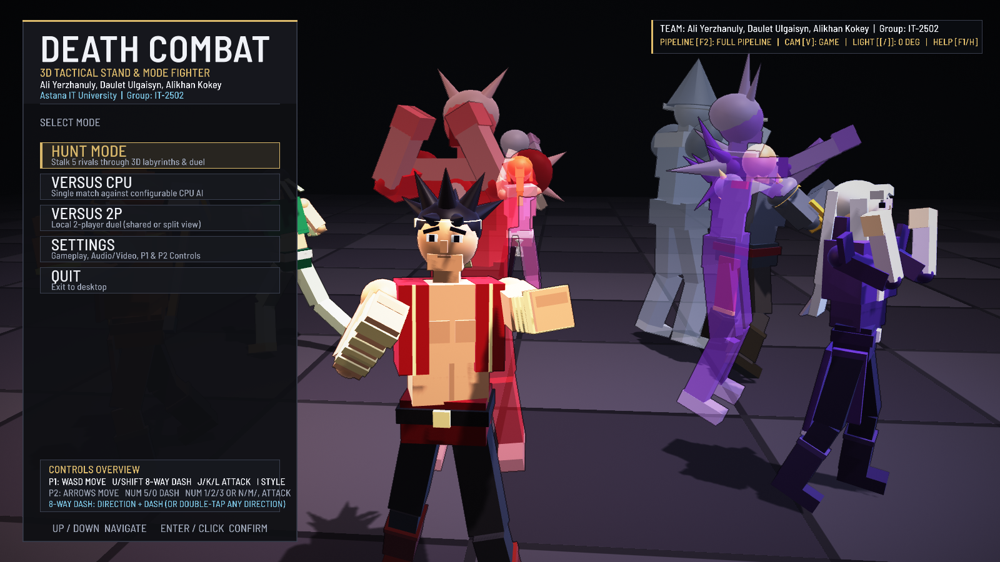
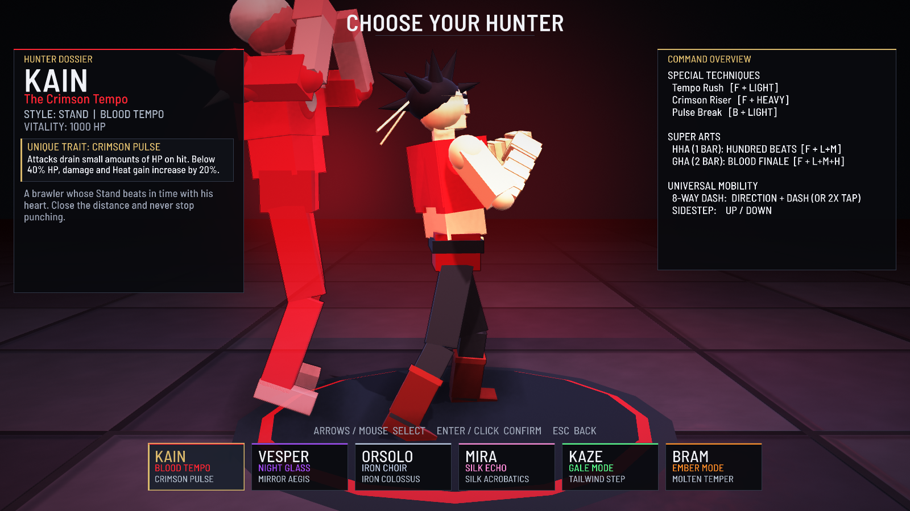
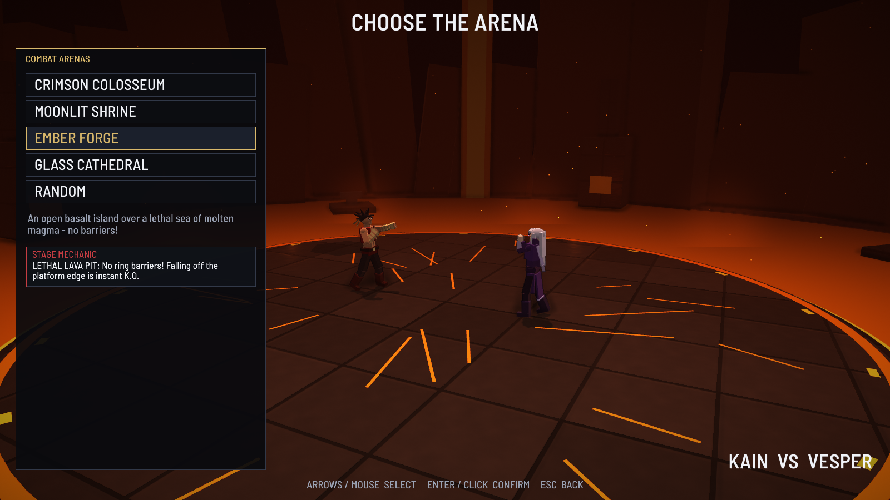
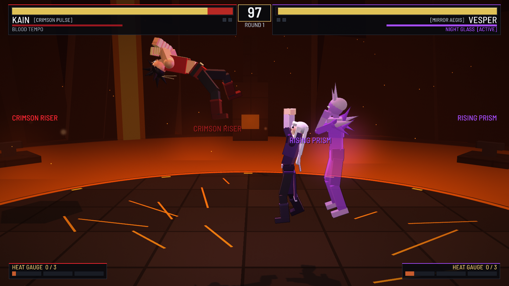

#  DEATH COMBAT

> **Astana IT University — Computer Graphics Fundamentals (Final Project)**
> - **Topic Title:** Death Combat
> - **Authors:** Ali Yerzhanuly, Daulet Ulgaisyn, Alikhan Kokey
> - **Group:** IT-2502

A cross-platform 3D tactical arena fighting and labyrinth-hunt game written from scratch in **C++17** and **OpenGL 3.3 Core Profile**.
No external game engine or asset pipeline: every 3D mesh, character rig, animation, GLSL shader (`shaders/*.vert`, `shaders/*.frag`), sound synthesizer, and UI panel is generated and rendered procedurally in code.

**The Hook:** In **Hunt Mode**, you do not pick your opponent from a bracket. You stalk a procedurally generated 3D labyrinth of corridors, following your *Death Sense* and heartbeat, until you track down one of the five rival fighters. When you engage them, the game transitions seamlessly into a 60 Hz 3D arena battle inspired by *JoJo's Bizarre Adventure: All-Star Battle* — complete with Stands, Power Modes, Unique Character Traits, 8-Way Omnidirectional Dashing, Heart Heat Gauge, HHA / GHA Supers, Flash Cancel, Stylish Evade, Stand Break, and Rush Mode clashes.

---

## Screenshots

| Title Screen | Character Select (Dossier & Unique Trait) |
|---|---|
|  |  |

| Stage Select (Ember Forge) | Arena Combat |
|---|---|
|  |  |

---

## Installation & Building from GitHub / Инструкция по установке с GitHub

### Prerequisites / Требования
- **Git**
- **CMake 3.16+**
- **C++17 compiler** (Visual Studio 2019/2022, MSYS2 MinGW-w64 GCC/Clang on Windows; GCC or Clang on Linux)
- **GLFW 3.3+** (automatically used if installed on the system, or downloaded automatically by CMake `FetchContent` on first configure)

### 1. Clone the Repository / Клонирование репозитория

```bash
git clone https://github.com/<your-username>/Death-Combat.git
cd Death-Combat
```

### 2. Build & Run on Windows

#### Option A: Visual Studio 2019 / 2022 (Recommended on Windows)
```bat
cmake -B build
cmake --build build --config Release
build\Release\DeathCombat.exe
```
*(You can also open the `Death-Combat` folder directly in Visual Studio via **File → Open → Folder** and press **F5** to build and run `DeathCombat.exe`.)*

#### Option B: MSYS2 / MinGW-w64 (UCRT64 / Mingw64)
```powershell
# Optional: install dependencies in MSYS2 UCRT64 shell
# pacman -S mingw-w64-ucrt-x86_64-gcc mingw-w64-ucrt-x86_64-cmake mingw-w64-ucrt-x86_64-glfw

cmake -B build -G "MinGW Makefiles" -DCMAKE_BUILD_TYPE=Release
cmake --build build --parallel 4
.\build\DeathCombat.exe
```

### 3. Build & Run on Linux

```bash
# Debian / Ubuntu:
sudo apt update && sudo apt install -y git cmake g++ libglfw3-dev libgl1-mesa-dev
# Arch Linux:
# sudo pacman -S git cmake gcc glfw

cmake -B build -DCMAKE_BUILD_TYPE=Release
cmake --build build -j
./build/DeathCombat
```

### 4. Running the Automated Test Suite / Запуск тестов

```bash
ctest --test-dir build --output-on-failure
```

---

## Key Features & Gameplay Mechanics

### Smooth Movement & 8-Way Omnidirectional Dash
- **Smooth Acceleration & Pose Blending:** Ground movement in both Fight and Hunt modes features smooth velocity interpolation and fluid skeletal pose transitions (`lerpPose`) across idle, walk, crouch, dash, jump, and attack states.
- **Omnidirectional Dash (8-Way / 360°):** Press **Dash (`U` / `Left Shift`) + any movement direction** (Forward, Back, Left, Right, or any diagonal) — or **double-tap any movement key (`W`, `A`, `S`, `D`)** — to dash in that exact direction.
  - **Forward & Forward-Diagonal Dash:** High-speed gap closer that carries momentum into attacks.
  - **Backward & Back-Diagonal Dash:** Evasive retreat with brief strike and throw invulnerability.
  - **Lateral Sidestep (Stylish Evade):** Pure sideways dash (`Dash + W/S` or double-tap `W/S`) hops around linear attacks and projectiles with strike/throw invulnerability.

### Combat System
- **Normals & Chains:** Standing, crouching, and jumping Light (`J`), Medium (`K`), and Heavy (`L`) attacks that chain `L → M → H`.
- **Easy Beat Auto-Combo:** Rapidly tapping Light (`J`) automatically chains `L → M → H → Special`. Can be toggled independently for **Player 1** and **Player 2** in **Settings**.
- **Specials & Motion Inputs:** Perform specials with simplified directional inputs (`Forward + L/M`, `Back + L/M`, `Forward + H`) or classic arcade motions (`236` QCF, `214` QCB, `623` DP).
- **Heart Heat Gauge (HHG):** Up to 3 bars of meter shared across rounds:
  - **Heart Heat Attack (HHA — 1 Bar):** `Forward + Light + Medium` (invincible startup super).
  - **Great Heat Attack (GHA — 2 Bars):** `Forward + Light + Medium + Heavy` (cinematic ultimate super; triggers a **Dramatic Finish** on final KO).
  - **Flash Cancel (1 Bar):** Press `Light + Medium + Heavy` during an attack to cancel recovery into immediate pressure or combos.
- **Styles (Stands & Modes):**
  - **Stand Users** (`KAIN`, `VESPER`, `ORSOLO`, `MIRA`) summon an ethereal translucent Stand behind them (`Style` button `I`) for extended reach and Stand-specific specials. Taking damage while Stand is active drains the Style Gauge; emptying it triggers a **Stand Break** stun.
  - **Mode Users** (`KAZE`, `BRAM`) activate an elemental overdrive that boosts speed, damage, and trait effects while burning Style fuel.

---

## Roster & Unique Character Traits

Every fighter has **1,000 HP**, a distinct procedural model and signature menu pose, a Stand or Mode style, and a **Unique Passive Trait**:

| Fighter | Style | Unique Trait | Trait Effect & Playstyle |
|---|---|---|---|
| **KAIN**<br>*The Crimson Tempo* | **Stand:**<br>`BLOOD TEMPO` | **CRIMSON PULSE** | Below 40% HP, Kain enters Blood Rush (+20% damage dealt) and lifesteals 25% of all unblocked Stand attack damage. Aggressive close-range brawler. |
| **VESPER**<br>*The Night Glass* | **Stand:**<br>`NIGHT GLASS` | **MIRROR AEGIS** | Successful blocks grant +60% bonus Heart Heat and reflect glass shard damage back at nearby attackers. Stand hits chill foes (-25% move speed). |
| **ORSOLO**<br>*The Iron Choir* | **Stand:**<br>`IRON CHOIR` | **IRON COLOSSUS** | Standing and crouching Heavy normals gain 1 hit of startup super-armor; takes 12% less damage and 35% less knockback from all hits. Towering grappler. |
| **MIRA**<br>*The Silk Echo* | **Stand:**<br>`SILK ECHO` | **SILK ACROBATICS** | Can perform an **Air Dash** or **Double Jump** once per jump and cancel air normals directly into air specials. High-mobility aerial specialist. |
| **KAZE**<br>*The Gale* | **Mode:**<br>`GALE MODE` | **TAILWIND STEP** | Every directional dash charges *Wind Step* for 1.25s, boosting Kaze's movement speed by +15% and his next attack's damage by +18%. |
| **BRAM**<br>*The Ember* | **Mode:**<br>`EMBER MODE` | **MOLTEN TEMPER** | Attacks while Ember Mode is active ignite opponents for 3 seconds of burn damage over time and deal 2.2x chip damage against blocking foes. |

---

## Arenas & Hunting Grounds

### Combat Arenas (with Stage Mechanics)

| Arena | Architectural Landmarks | Stage Mechanic / Hazard |
|---|---|---|
| **CRIMSON COLOSSEUM** | Torch-lit brick amphitheater, imperial tribune balcony, 8 roaring bronze braziers, crimson war banners. | **BLOODLUST CROWD:** Hits build **+25% bonus Heart Heat** for both fighters. |
| **MOONLIT SHRINE** |Sacred stone courtyard under a full moon, vermilion Torii gates with Shimenawa ropes & paper shide, stone lanterns, sakura trees & falling blossoms. | **SERENE SPIRIT:** **+50% passive Style Gauge regeneration** and slightly lighter lunar gravity. |
| **EMBER FORGE** | Open basalt rock island surrounded by a molten magma sea, scorched warning runes, 4 towering lava waterfalls, and giant crucible anvils. | **LETHAL LAVA PIT (No Barriers):** There are **no outer walls** — stepping, dashing, or being knocked off the platform edge drops the fighter into the molten lava for an **instant K.O. (`BURNED IN LAVA!`)**. |
| **GLASS CATHEDRAL** | Gothic nave with flying buttress arches, stained-glass rose windows, altar candle candelabra, and a towering golden pipe organ. | **RESONANT SANCTUM:** Expansive floor (`R = 10.2m`), **+20% projectile speed**, and **25% Heat refund on Flash Cancel**. |

### Labyrinth Hunting Grounds (Hunt Mode)
- **CATACOMBS:** Tight subterranean brick corridors with skull alcoves, corner pillars, and flickering wall torches.
- **MOONLIT GARDEN:** Overgrown nocturnal hedge labyrinth with vermilion mini-Torii crossroad markers, stone lanterns, and drifting fireflies.
- **EMBER FOUNDRY:** Industrial iron tunnels with glowing magma floor grates and brass-riveted furnace columns.

---

## Controls & 2-Player Configuration

All controls for **both Player 1 and Player 2** (2 key slots per action) can be rebound in **Settings → Player 1** and **Settings → Player 2**.

| Action | Player 1 Default (Keyboard) | Player 2 Default (Keyboard) | Gamepad (XInput / Standard) |
|---|---|---|---|
| **Move / Strafe** | `W` `A` `S` `D` | `Arrow Keys` | Left Stick / D-Pad |
| **Jump** | `Space` | `Right Shift` / `Numpad 8` | `A` (South) |
| **Crouch** | `Left Ctrl` / `C` | `Right Ctrl` / `Numpad 7` | `LT` |
| **Light Attack** | `J` | `Numpad 1` / `N` | `X` (West) |
| **Medium Attack** | `K` | `Numpad 2` / `M` | `Y` (North) |
| **Heavy Attack** | `L` | `Numpad 3` / `,` | `B` (East) |
| **Style (Stand / Mode)** | `I` | `Numpad 4` / `.` | `LB` |
| **8-Way Dash / Evade** | `U` / `Left Shift` *(or 2x tap direction)* | `Numpad 5` / `Numpad 0` *(or 2x tap)* | `RB` / `RT` |
| **Taunt** | `O` | `Numpad 6` / `/` | Right Stick Click |
| **Confirm / Pause** | `Enter` / `E` | `Numpad Enter` | `Start` |
| **Back / Pause** | `Esc` | `Esc` | `Back` |
| **Developer Mode** | `F3` | | |
| **Help & Pipeline Overlay** | `F1` / `H` | | |
| **Cycle Shader Pipeline** | `F2` | | |
| **Pause / Resume 3D Animation** | `P` | | |
| **3D Free-Orbit Camera** | `V` *(Mouse Drag / Arrows + `-`/`=` Zoom)* | | |
| **Rotate Sun Light Direction** | `[` / `]` *(Azimuth)*, `-` / `=` *(Elevation)*, `0` *(Reset)* | | |
| **Hot-Reload GLSL Shaders** | `F10` | | |
| **Screenshot** | `F12` | | |

---

## Computer Graphics Pipeline & Mathematical Foundation

All shaders are stored as external GLSL `#version 330 core` files in [`shaders/`](shaders/) and loaded dynamically at startup (with live hot-reloading via **`F10`**):

1. **Directional Shadow Mapping (`shaders/depth.vert`, `shaders/depth.frag`, `shaders/lit.frag`):**
   - Renders scene depth from an orthographic light-space projection ($M_{\text{light}} = P_{\text{ortho}} \cdot V_{\text{light}}$) into a `2048x2048` `GL_DEPTH_COMPONENT24` texture (`GL_COMPARE_REF_TO_TEXTURE`).
   - Samples a **3×3 Percentage-Closer Filtering (PCF)** kernel with slope-scaled normal bias $b = \max(0.0018(1 - \mathbf{N}\cdot\mathbf{L}), 0.0004)$ to eliminate shadow acne and produce soft shadow edges.
2. **Forward Lit Pass (`shaders/lit.vert`, `shaders/lit.frag`):**
   - **Key-Fill-Rim Blinn-Phong Illumination:**
     $$I = k_a I_a + S_{\text{PCF}}\Big(k_d \max(\mathbf{N}\cdot\mathbf{L}, 0) + k_s \max(\mathbf{N}\cdot\mathbf{H}, 0)^{36}\Big)\mathbf{C}_{\text{sun}} + k_{\text{rim}}(1 - \max(\mathbf{N}\cdot\mathbf{V}, 0))^3$$
   - **Multi-Point Light Attenuation:** Up to 8 dynamic point lights with smooth quadratic distance falloff $a(d) = \text{clamp}(1 - d/R, 0, 1)^2$.
   - **Tri-Planar Procedural Surface Patterns:** World-space marble tiles, staggered masonry bricks, and riveted steel plates computed analytically in the fragment shader.
   - **Atmospheric Fog:** Exponential squared fog $f = \exp(-(d \cdot \rho)^2)$.
3. **Dynamic Voronoi Split-Screen (`shaders/mask.frag`):**
   - When two fighters separate in 2P Versus mode, a hardware **Stencil Buffer (`GL_STENCIL_TEST`)** pass clips the second camera's viewport along the dynamic screen-space perpendicular bisector $(\mathbf{x}_{\text{frag}} - \mathbf{c})\cdot\mathbf{n}_{\text{split}} > 0$.
4. **HDR 4× MSAA Post-Processing (`shaders/post.vert`, `shaders/bright.frag`, `shaders/blur.frag`, `shaders/composite.frag`):**
   - Renders the 3D scene into a 4× MSAA `GL_RGBA16F` floating-point framebuffer, resolves to a single-sample HDR texture, extracts high-luminance regions (`bright.frag`), applies a **separable two-pass 9-tap Gaussian blur** (`blur.frag`), detects **linearized-depth Sobel silhouette edges** (`composite.frag`), and applies soft-knee ACES-inspired tone mapping and ordered dithering.
5. **15-Bone Hierarchical Skeletal Rig (`src/game/rig.cpp`):**
   - Every character and Stand is composed of a 15-joint articulated skeleton (`Hip`, `Waist`, `Chest`, `Neck`, `Head`, `ShoulderL/R`, `ElbowL/R`, `ShoulderPadL/R`, `HipL/R`, `KneeL/R`) evaluated via recursive local-to-world matrix composition:
     $$M_{\text{world}}(\text{joint}) = M_{\text{world}}(\text{parent}) \cdot T(\mathbf{p}_{\text{offset}}) \cdot R_z(\psi)\cdot R_x(\theta)\cdot R_y(\phi)$$

---

## 4-Tab Settings Menu

Accessible from the Title Screen or the in-game Pause Menu (`Esc`), organized into 4 intuitive tabs (`Q` / `E` / `Tab` or mouse click to switch):
1. **GAMEPLAY:** Language (`English`, `Русский`, `Қазақша`), Rounds to Win (`1..5`), Round Timer (`60s`, `99s`, `120s`, `Infinite`), CPU Difficulty (`Easy`, `Normal`, `Hard`), Damage Scale (`75%..150%`), Camera Shake (`Off`, `50%`, `100%`), Impact Hitstop (`On/Off`), HUD Control Hints (`On/Off`), Developer Mode (`Enabled/Disabled`), Reset All Settings.
2. **AUDIO & VIDEO:** Master Volume, Music Volume, Effects Volume, Display Mode (`Windowed` / `Fullscreen`), Window Size (`1280x720`, `1600x900`, `1920x1080`), VSync (`On/Off`), Render Pipeline (`Full`, `Direct`, `No Bloom`, `No Outline`, `No Shadows`), Camera FOV (`45°..70°`), Hunt Mouse Sensitivity.
3. **PLAYER 1:** P1 Easy Beat Auto-Combo (`On/Off`), Primary & Secondary key bindings for all P1 actions, Reset Player 1 Keys.
4. **PLAYER 2:** P2 Easy Beat Auto-Combo (`On/Off`), Primary & Secondary key bindings for all P2 actions, Reset Player 2 Keys.

---

## Developer Mode

Press **`F3`** at any time (or launch with `--dev` or enable **Developer Mode** in **Settings → Gameplay**) to activate the real-time diagnostic suite:
- **3D Wireframe Overlays (Fight Scene):**
  - **Hurtboxes:** 3D cylindrical wireframe hurtboxes (`Green` for P1, `Cyan` for P2, `Gold` when strike/throw-invulnerable).
  - **Active Hitboxes:** Bright `Red` 3D wireframe spheres rendered during active attack frames (`hw.start .. hw.end`), plus `Gold` projectile hitboxes.
  - **Arena Boundaries:** 3D boundary ring (`Gold` on walled arenas, `Red` hazard ring on Ember Forge's open lava cliff).
- **Telemetry Overlay:** Displays live FPS, frame time (ms), active scene, arena radius/hazard state, and per-fighter coordinates, velocity, state machine state, active move name, frame counter (`current / total`), stun timer, HP, Heat, and Style percentage.
- **Developer Hotkeys (when Developer Mode is active in Fight):**
  - `F3` — Toggle Developer Mode on/off
  - `F4` — Instant refill of HP, Heart Heat (`3000`), and Style Gauge (`100%`) for both fighters
  - `F5` — Pause / resume simulation frames
  - `F6` — Step forward exactly **1 frame** (`1/60s`) while paused
  - `F7` — Toggle `0.25x` slow-motion analysis
  - `F8` — Toggle Player 2 CPU AI on/off
  - `F9` — Cycle live through all 4 combat arenas

---

## Command-Line Options

```text
DeathCombat --dev                   Enable Developer Mode overlay & hitboxes on startup
DeathCombat --demo-fight            AI vs AI fight
DeathCombat --demo-hunt             Jump straight into Hunt Mode
DeathCombat --demo-select --char 3  Open Character Select focused on fighter #3 (0..5)
DeathCombat --demo-arenas --arena 2 Open Arena Select focused on arena #2 (0..3)
DeathCombat --demo-grounds          Open Hunting Ground Select
DeathCombat --demo-settings         Open Settings screen
DeathCombat --demo-split            Versus match split-screen camera test
DeathCombat --shot out.png 5        Save a PNG screenshot after 5 seconds and quit
DeathCombat --seed 42               Deterministic RNG seed for maze / effects
DeathCombat --render-debug <mode>   full | direct | no-bloom | no-outline | no-shadows
```
