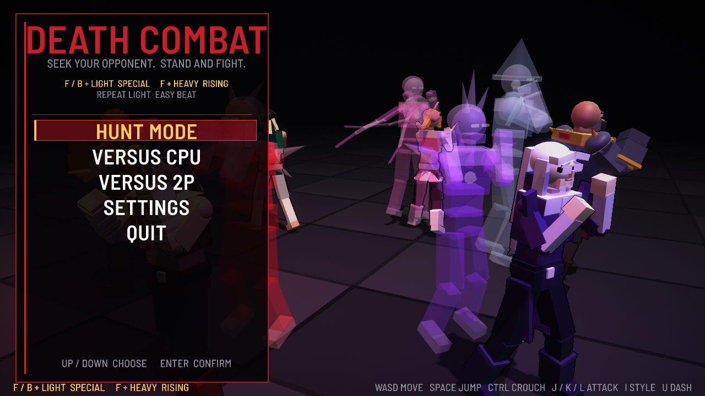
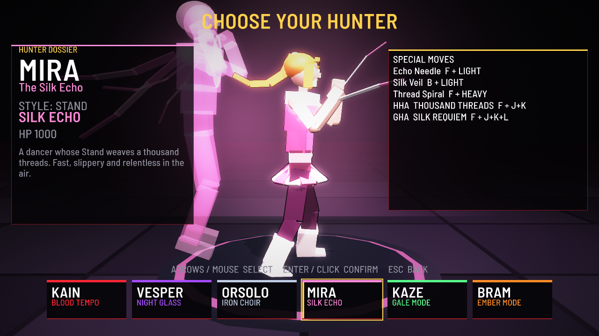
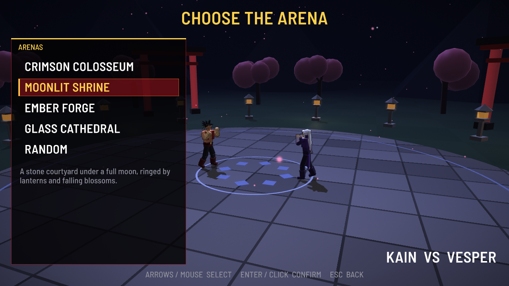
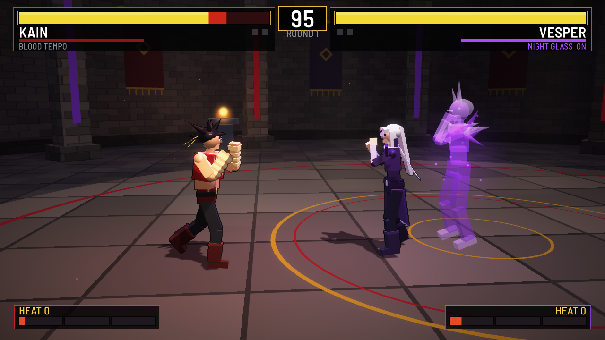

# DEATH COMBAT

A cross-platform 3D fighting game written from scratch in C++17 and OpenGL 3.3.
No engine, no asset pipeline: every mesh, animation, font and effect is generated in code.

**The hook:** you do not pick your opponent from a menu. You stalk a procedurally generated
labyrinth of corridors, following your *Death Sense*, until you find one of the five hidden fighters.
When you find them, the fight is a 3D arena brawl with the mechanics of
*JoJo's Bizarre Adventure: All-Star Battle*: Stands, Heart Heat Gauge, HHA / GHA, Flash Cancel,
Stylish Evade, Easy Beat chains, Stand Break and Rush Mode clashes.

## Screenshots

| Title screen | Character select |
|---|---|
|  |  |

| Arena select | Fight |
|---|---|
|  |  |

## Building

The only dependency is [GLFW](https://www.glfw.org). It is taken from the system when installed,
otherwise CMake downloads and builds it automatically (needs network on first configure).
The OpenGL loader (GLAD) is vendored in `third_party/glad`.

### Linux

```bash
sudo apt install cmake g++ libglfw3-dev          # Debian / Ubuntu (optional, GLFW is fetched otherwise)
# sudo pacman -S cmake gcc glfw                  # Arch
cmake -B build -DCMAKE_BUILD_TYPE=Release
cmake --build build -j
./build/DeathCombat
```

### Windows

With Visual Studio 2019/2022 (C++ workload, which includes CMake):

```bat
cmake -B build
cmake --build build --config Release
build\Release\DeathCombat.exe
```

Or open the folder in Visual Studio ("Open a local folder"), pick the `DeathCombat` target and run.
MinGW-w64 / clang work as well: `cmake -B build -G Ninja && cmake --build build`.

### Tests

Run the CTest suite from the build directory to check the simulation, character rigs, font layout,
and localization:

```bash
ctest --test-dir build --output-on-failure
```

## How to play

The interface is available in English, Russian, and Kazakh. Change **Language** in **Settings**;
your choice is saved with the other settings.

### Modes

- **HUNT MODE** – choose a hunter and a hunting ground, then search it for the other five fighters. Beat them all.
  Each opponent fights you in their own home arena.
- **VERSUS CPU** – a single match against the computer, in the arena of your choice.
- **VERSUS 2P** – two players on one machine (keyboard + keyboard, or gamepads). When the two of you get too far
  apart the screen splits so each player keeps their fighter in view; it opens and closes gradually.

### Controls

| Action | Keyboard (P1) | Keyboard (P2) | Gamepad |
|---|---|---|---|
| Move (fights: W / S circle the opponent) | W A S D | Arrows | Left stick / D-pad |
| Jump | Space | Right Shift / Numpad 8 | A |
| Crouch | Left Ctrl or C | Right Ctrl / Numpad 7 | LT |
| Light attack | J | Numpad 1 | X |
| Medium attack | K | Numpad 2 | Y |
| Heavy attack | L | Numpad 3 | B |
| Style (Stand / Mode on-off) | I | Numpad 4 | LB |
| Dash / evade | U or Shift | Numpad 5 / 0 | RB / RT |
| Taunt | O | Numpad 6 | Right stick press |
| Confirm / engage / pause | Enter or E | Numpad Enter | Start |
| Back / pause | Esc | | Back |
| Hunt: look | Mouse (Q / R to turn) | | Right stick |
| Hunt: run | Shift | | RB |
| Screenshot | F12 | | |

Player 1's keys (including Jump and Crouch) can be rebound in **Settings**.

### Free movement and the camera

Fighters walk freely around a round arena and always stay turned toward each other. Movement is relative to the
camera, and the camera stays side-on to the two fighters (like Tekken or Soul Calibur), so **left / right still means
toward / away** – blocking, F / B specials and motion inputs work exactly as in a 2D fighter – while **up / down walks
around the opponent**. Attacks travel in the direction you face, so stepping to the side really dodges them.
The camera turns and zooms smoothly to keep both fighters framed and never goes behind the arena walls.
Against the CPU, if the opponent leaves the screen an arrow at the edge points at them.

### Maps

| Arena | | Hunting ground | |
|---|---|---|---|
| Crimson Colosseum | torch-lit brick hall with banners | Catacombs | tight brick corridors |
| Moonlit Shrine | stone courtyard, lanterns, falling blossoms | Moonlit Garden | open-sky hedge maze with fireflies |
| Ember Forge | rock island in a moat of molten iron | Ember Foundry | iron tunnels with furnace vents |
| Glass Cathedral | stained glass and a marble floor | | |

Pick one on the stage screen after choosing fighters (or **Random**); the preview shows the place live.

### The hunt

- Your **Death Sense** meter and heartbeat get stronger as you get closer (by corridor distance) to the nearest opponent.
  Once you are close enough it also tells you which way the trail goes.
- Opponents wander. If they see you they will come for you ("YOU ARE BEING HUNTED").
- Walk into an opponent, or press Enter / an attack button next to them, to start the fight.
- Win and you return to the halls; the remaining opponents scatter and get tougher. Lose and you can retry.

The dark, crimson menus and in-fight HUD frame the matches; each character keeps a distinct moveset
and playstyle despite the shared health baseline.

### Fight mechanics

- **Normals:** Light, Medium, Heavy, standing / crouching / in the air. Chains go L → M → H.
- **Easy Beat:** tap Light repeatedly for an automatic L → M → H → special combo.
- **Simplified specials:** hold toward + Light/Medium for a character's signature forward special, away + Light/Medium for their back special, or toward + Heavy for their rising special. Quarter-circle and dragon-punch inputs still work.
- **Easy Heat attacks:** hold toward and press Light + Medium for an HHA, or Light + Medium + Heavy for a GHA; classic quarter-circle inputs still work too.
- **Throw:** L + M close to the opponent. Both throwing at once = throw tech.
- **Dash / backdash:** Dash button with forward / back, or double-tap. Backdash is briefly invincible.
- **Sidestep (Stylish Evade):** Dash + sideways (W / S) hops around attacks with brief invincibility, also out of block stun.
- **Blocking:** hold back. Low attacks must be crouch-blocked, overheads must be blocked standing.
- **Heart Heat Gauge (HHG):** fills when hitting and being hit, up to 3 bars. It persists between rounds.
  - **Heart Heat Attack (HHA):** toward + Light + Medium, or D, DF, F + two attack buttons. 1 bar, invincible start-up.
  - **Great Heat Attack (GHA):** toward + Light + Medium + Heavy, or D, DF, F + three attack buttons. 2 bars, huge damage.
  - **Flash Cancel:** press L + M + H during any move to cancel it. 1 bar.
  - Finish a round with an HHA or GHA for a **Dramatic Finish**.
- **Styles:**
  - **Stand users** (KAIN, VESPER, ORSOLO, MIRA) toggle their Stand with the Style button. Stand On gives longer,
    stronger normals, but hits taken drain the Stand gauge. When it empties: **Stand Break**, a long stun.
  - **Mode users** (KAZE, BRAM) burn their gauge for a power mode: more damage and speed until it runs out.
- All fighters have the same **1,000 HP**; their identities come from movement, range, signature attacks, and Stand / Mode mechanics.
- **Rush Mode:** when two rush attacks collide, a clash starts. Mash attack buttons to win it.
- **Taunt** while the opponent is down to drain their Heart Heat.
- Best of three rounds, 99-second timer.

## Roster

| Fighter | Style | Playstyle |
|---|---|---|
| KAIN – *Blood Tempo* | Stand | Rushdown: Stand barrage, uppercut, overhead stomp |
| VESPER – *Night Glass* | Stand | Zoner: glass shard projectiles, anti-air prism, slide |
| ORSOLO – *Iron Choir* | Stand | Grappler: armored lariat, command throws, headbutt launcher |
| MIRA – *Silk Echo* | Stand | Fast and slippery: needle rush, low slide, spinning launcher |
| KAZE – *Gale Mode* | Mode | Speed: flying kicks, slide, rising knee |
| BRAM – *Ember Mode* | Mode | Power: armored straight, low fire wave, launcher |

## Project layout

```
src/core        math, embedded TrueType/SDF fonts, localization, PNG writer
src/gfx         shaders, procedural meshes, forward renderer (shadow map, point lights, fog, particles, 2D HUD)
src/game        input, roster & move data, fight simulation (60 Hz fixed step, free movement on a round arena),
                fight AI, procedural humanoid rig & animation, arenas, themed maze generator, hunt phase,
                app / scenes / follow camera / split screen / HUD
tests           headless simulation test
third_party     GLAD OpenGL loader
```

Design notes:

- The fight simulation is deterministic and independent of rendering (`src/game/fight.*`). It takes two
  `SimInput`s per 60 Hz tick and emits `FightEvent`s that the presentation turns into particles, text and shake.
- All move data lives in `src/game/characters.cpp` as plain structs: frame data, hitboxes, cancel rules.
- Characters are block-figure rigs posed procedurally (`src/game/rig.*`): every animation is a function of state and time.

### Debug options

```
DeathCombat --demo-fight            AI vs AI fight
DeathCombat --demo-hunt             straight into the hunt
DeathCombat --shot out.png 5        save a screenshot after 5 seconds and quit
DeathCombat --seed 42               deterministic maze / effects
DeathCombat --demo-select --char 3  character select showing fighter #3 (also picks the fighter for --demo-fight / --demo-hunt)
DeathCombat --demo-fight --arena 2  AI vs AI fight in arena #2 (0..3); with --demo-hunt it picks the hunting ground (0..2)
DeathCombat --demo-arenas           arena select screen        (--demo-grounds: hunting ground select)
DeathCombat --demo-split            versus match where both players back away and return: split screen check
```
