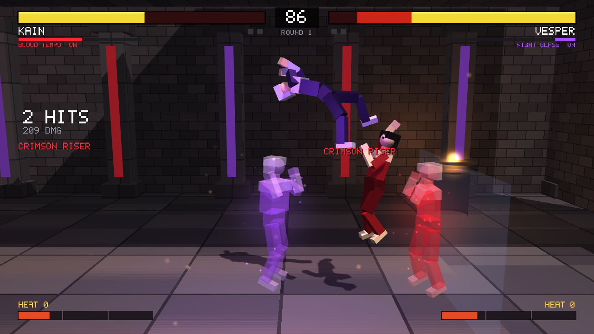

# DEATH COMBAT

A cross-platform 3D fighting game written from scratch in C++17 and OpenGL 3.3.
No engine, no asset pipeline: every mesh, animation, font and effect is generated in code.

**The hook:** you do not pick your opponent from a menu. You stalk a procedurally generated
labyrinth of corridors, following your *Death Sense*, until you find one of the five hidden fighters.
When you find them, the fight is a 3D arena brawl with the mechanics of
*JoJo's Bizarre Adventure: All-Star Battle*: Stands, Heart Heat Gauge, HHA / GHA, Flash Cancel,
Stylish Evade, Easy Beat chains, Stand Break and Rush Mode clashes.



## Building

The only dependency is [GLFW](https://www.glfw.org). It is taken from the system when installed,
otherwise CMake downloads and builds it automatically (needs network on first configure).
The OpenGL loader (GLAD) is vendored in `third_party/glad`.

### Linux

```bash
sudo apt install cmake g++ libglfw3-dev          # Debian / Ubuntu (optional, GLFW is fetched otherwise)
# sudo pacman -S cmake gcc glfw                  # Arch
cmake -B build -DCMAKE_BUILD_TYPE=Release
cmake --build build -j
./build/DeathCombat
```

### Windows

With Visual Studio 2019/2022 (C++ workload, which includes CMake):

```bat
cmake -B build
cmake --build build --config Release
build\Release\DeathCombat.exe
```

Or open the folder in Visual Studio ("Open a local folder"), pick the `DeathCombat` target and run.
MinGW-w64 / clang work as well: `cmake -B build -G Ninja && cmake --build build`.

### Tests

`DeathCombatSimTest` runs every AI matchup of the fight simulation headlessly (no window) and checks
that matches finish and the mechanics fire:

```bash
./build/DeathCombatSimTest     # or: ctest --test-dir build
```

## How to play

### Modes

- **HUNT MODE** – choose a hunter, then search the corridors for the other five fighters. Beat them all.
- **VERSUS CPU** – a single match against the computer.
- **VERSUS 2P** – two players on one machine (keyboard + keyboard, or gamepads).

### Controls

| Action | Keyboard (P1) | Keyboard (P2) | Gamepad |
|---|---|---|---|
| Move / jump / crouch | W A S D | Arrows | Left stick / D-pad |
| Light attack | J | Numpad 1 | X |
| Medium attack | K | Numpad 2 | Y |
| Heavy attack | L | Numpad 3 | B |
| Style (Stand / Mode on-off) | I | Numpad 4 | A |
| Dash / evade | U, Shift or Space | Numpad 5 / 0 | RB / RT |
| Taunt | O | Numpad 6 | LB |
| Confirm / engage / pause | Enter or E | Numpad Enter | Start |
| Back / pause | Esc | | Back |
| Hunt: look | Mouse (Q / R to turn) | | Right stick |
| Hunt: run | Shift | | RB |
| Screenshot | F12 | | |

### The hunt

- Your **Death Sense** meter and heartbeat get stronger as you get closer (by corridor distance) to the nearest opponent.
  Once you are close enough it also tells you which way the trail goes.
- Opponents wander. If they see you they will come for you ("YOU ARE BEING HUNTED").
- Walk into an opponent, or press Enter / an attack button next to them, to start the fight.
- Win and you return to the halls; the remaining opponents scatter and get tougher. Lose and you can retry.

### Fight mechanics (ASB style)

- **Normals:** Light, Medium, Heavy, standing / crouching / in the air. Chains go L → M → H.
- **Easy Beat:** tap Light repeatedly for an automatic L → M → H → special combo.
- **Specials:** quarter-circle forward (D, DF, F), quarter-circle back (D, DB, B) and dragon punch (F, D, DF) plus an attack button. Strength changes with the button.
- **Throw:** L + M close to the opponent. Both throwing at once = throw tech.
- **Dash / backdash:** Dash button with forward / back, or double-tap. Backdash is briefly invincible.
- **Sidestep (Stylish Evade):** Dash + up / down steps around attacks, also out of block stun.
- **Blocking:** hold back. Low attacks must be crouch-blocked, overheads must be blocked standing.
- **Heart Heat Gauge (HHG):** fills when hitting and being hit, up to 3 bars. It persists between rounds.
  - **Heart Heat Attack (HHA):** D, DF, F + two attack buttons. 1 bar, invincible start-up.
  - **Great Heat Attack (GHA):** D, DF, F + three attack buttons. 2 bars, huge damage.
  - **Flash Cancel:** press L + M + H during any move to cancel it. 1 bar.
  - Finish a round with an HHA or GHA for a **Dramatic Finish**.
- **Styles:**
  - **Stand users** (KAIN, VESPER, ORSOLO, MIRA) toggle their Stand with the Style button. Stand On gives longer,
    stronger normals, but hits taken drain the Stand gauge. When it empties: **Stand Break**, a long stun.
  - **Mode users** (KAZE, BRAM) burn their gauge for a power mode: more damage and speed until it runs out.
- **Rush Mode:** when two rush attacks collide, a clash starts. Mash attack buttons to win it.
- **Taunt** while the opponent is down to drain their Heart Heat.
- Best of three rounds, 99-second timer.

## Roster

| Fighter | Style | Playstyle |
|---|---|---|
| KAIN – *Blood Tempo* | Stand | Rushdown: Stand barrage, uppercut, overhead stomp |
| VESPER – *Night Glass* | Stand | Zoner: glass shard projectiles, anti-air prism, slide |
| ORSOLO – *Iron Choir* | Stand | Grappler: armored lariat, command throws, headbutt launcher |
| MIRA – *Silk Echo* | Stand | Fast and slippery: needle rush, low slide, spinning launcher |
| KAZE – *Gale Mode* | Mode | Speed: flying kicks, slide, rising knee |
| BRAM – *Ember Mode* | Mode | Power: armored straight, low fire wave, launcher |

## Project layout

```
src/core        math, embedded 5x7 font, PNG writer
src/gfx         shaders, procedural meshes, forward renderer (shadow map, point lights, fog, particles, 2D HUD)
src/game        input, roster & move data, fight simulation (60 Hz fixed step), fight AI,
                procedural humanoid rig & animation, maze generator, hunt phase, app / scenes / HUD
tests           headless simulation test
third_party     GLAD OpenGL loader
```

Design notes:

- The fight simulation is deterministic and independent of rendering (`src/game/fight.*`). It takes two
  `SimInput`s per 60 Hz tick and emits `FightEvent`s that the presentation turns into particles, text and shake.
- All move data lives in `src/game/characters.cpp` as plain structs: frame data, hitboxes, cancel rules.
- Characters are block-figure rigs posed procedurally (`src/game/rig.*`): every animation is a function of state and time.

### Debug options

```
DeathCombat --demo-fight            AI vs AI fight
DeathCombat --demo-hunt             straight into the hunt
DeathCombat --shot out.png 5        save a screenshot after 5 seconds and quit
DeathCombat --seed 42               deterministic maze / effects
```
