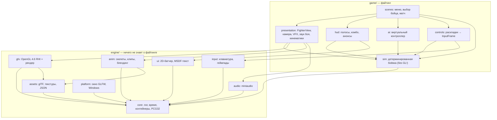
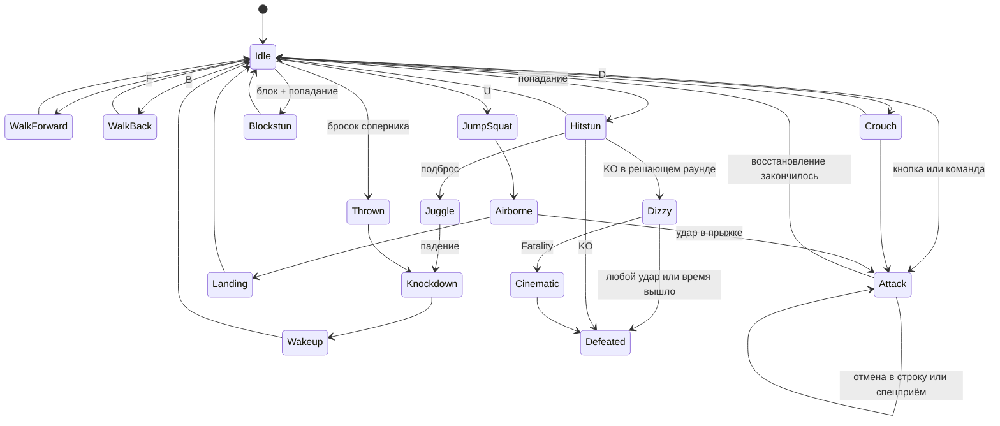
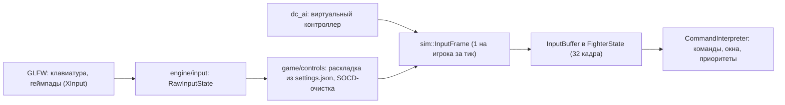
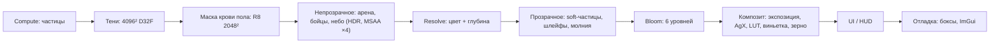
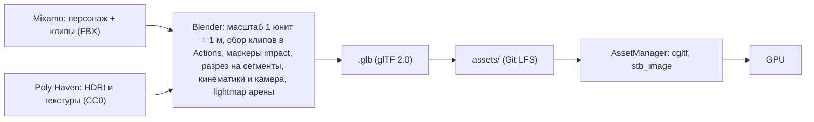
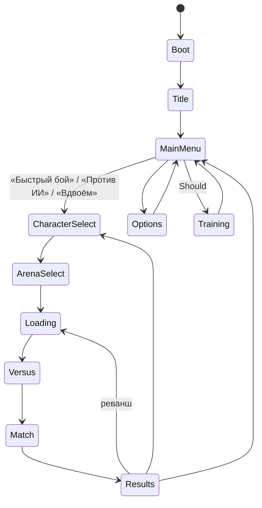

# Death Combat — архитектура

> 3D-файтинг на C++20 и OpenGL 4.6 без игрового движка. Ориентир по жанру, темпу и подаче — Mortal Kombat 11.
>
> Статус: **черновик v1**, 2026-10-15. Продуктовый контекст: [PRODUCT.md](../PRODUCT.md).
> Составлено с помощью навыков ECC (`cpp-coding-standards`, `architecture-decision-records`) и impeccable (`init`, `shape`).

## Содержание

0. [Рамки проекта](#0-рамки-проекта)
1. [Цели качества](#1-цели-качества)
2. [Обзор: симуляция отдельно от представления](#2-обзор-симуляция-отдельно-от-представления)
3. [Главный цикл и время](#3-главный-цикл-и-время)
4. [Симуляция боя (`dc_sim`)](#4-симуляция-боя-dc_sim)
5. [Ввод](#5-ввод)
6. [ИИ](#6-ии-dc_ai)
7. [Представление: анимация, камера, VFX, звук, кинематики](#7-представление-dc_presentation)
8. [Рендер на OpenGL 4.6](#8-рендер-на-opengl-46-dc_gfx)
9. [Ассеты и контент-пайплайн](#9-ассеты-и-контент-пайплайн-dc_assets)
10. [Поток игры и интерфейс](#10-поток-игры-и-интерфейс)
11. [Инструменты, тесты, профилирование](#11-инструменты-тесты-профилирование)
12. [Репозиторий, сборка, стандарты кода](#12-репозиторий-сборка-стандарты-кода)
13. [Перенос прототипа](#13-перенос-прототипа)
14. [Дорожная карта](#14-дорожная-карта)
15. [Риски](#15-риски)
16. [Архитектурные решения (ADR)](#16-архитектурные-решения-adr)
17. [Словарь](#17-словарь)

---

## 0. Рамки проекта

| Вопрос | Решение |
|---|---|
| Движок | Нет. Рендер, анимацию, боёвку и физику пишем сами |
| Разрешённые библиотеки | GLFW (окно, ввод, геймпады), GLAD (загрузчик GL), GLM (математика), cgltf (glTF), stb_image, miniaudio, Dear ImGui (только отладка), nlohmann/json, spdlog; для разработки Tracy и doctest |
| Платформа | Только Windows 10/11 x64, **OpenGL 4.6 core profile** |
| Объём | 2 бойца, 1–2 арены, 1v1 против ИИ и вдвоём, комбо, спецприёмы, Fatal Blow, Finish Him + Fatality, меню и выбор бойца |
| Рабочее допущение | Модели и базовые анимации берём из Mixamo, дорабатываем в Blender и экспортируем в glTF 2.0 (`.glb`). Если у команды будут свои модели, изменится только [раздел 9](#9-ассеты-и-контент-пайплайн-dc_assets) |

**Уровни объёма**, чтобы сроки не съели качество:

| Уровень | Что входит |
|---|---|
| **Must** (MVP) | 2 бойца: по ~12 обычных ударов, 3 спецприёма, комбо-строки. Блок, броски, прыжки, присед. Джагглы и скейлинг урона, хитстоп. Раунды до двух побед, таймер. Finish Him и по одному Fatality на бойца. ИИ трёх уровней, игра вдвоём. Одна арена, HUD, главное меню, выбор бойца, пауза, настройки. PBR + IBL + тени + bloom. Кровь на полу. Звук, музыка, анонсер |
| **Should** | Fatal Blow с кинематикой у каждого. Вторая арена. Тренировочный режим. Экран Versus, победные позы, кровь, копящаяся на бойцах |
| **Could** | Второй Fatality, Brutality, Krushing Blow, рэгдолл, DOF в кинематиках, сохранение повторов, онлайн с rollback (архитектура к нему готова, см. ADR-0003) |
| **Won't** | Сюжетный режим, кастомизация, онлайн-лобби, больше двух бойцов |

## 1. Цели качества

«Должно быть качественно» в измеримом виде:

| Метрика | Цель |
|---|---|
| Частота симуляции | Ровно 60 тиков в секунду, все тайминги в кадрах |
| Частота кадров | Стабильные 60 fps в 1080p на GTX 1050 / RX 560. На 144-Гц мониторах рендер интерполируется |
| Задержка ввода | Не больше 3 кадров от нажатия до первого изменённого кадра (с vsync) |
| Путь до боя | Не больше 30 с от запуска `.exe` до «FIGHT!» через «Быстрый бой» |
| Загрузка матча | Не больше 5 с с SSD |
| Детерминизм | Один и тот же поток ввода даёт один и тот же хеш состояния на каждом кадре. Проверяется тестом в CI |
| Стабильность | Ни одного сообщения GL debug output уровня HIGH, ни одного утёкшего GL-объекта при выходе |

**Почему удар ощущается мощным** (в MK11 это работает так же; чек-лист для каждого приёма):
хитстоп (заморозка на 4–12 кадров), искры и кровь в точке контакта, тряска камеры по модели «trauma», вспышка на теле получившего удар, многослойный звук (щелчок, тело удара, хвост), анимация с маркером `impact`, совпадающим с первым активным кадром, отталкивание соперника.

## 2. Обзор: симуляция отдельно от представления

Главная идея архитектуры: **что происходит в бою** и **как это выглядит и звучит** — два разных мира.

- **Симуляция** (`dc_sim`) — детерминированная боёвка на целых числах. Без GL, без звука, без часов. На вход получает состояние и ввод, на выходе даёт новое состояние и список событий.
- **Представление** (`dc_presentation`, `dc_gfx`, `dc_anim`, `dc_audio`, `dc_hud`) читает состояние и события и рисует, анимирует, озвучивает. На исход боя оно не влияет никогда.



**Правила зависимостей** (проверяются CMake: цель просто не слинкуется):

1. `engine/*` не подключает ничего из `game/*`.
2. `dc_sim` зависит только от `dc_core`. Попытка подключить `glad` или `glfw` в симуляции — ошибка сборки.
3. Представление читает симуляцию и никогда её не изменяет.
4. ИИ общается с симуляцией только через `InputFrame`, как человек с геймпадом.

### 2.1 Путь одного удара

Как одно нажатие проходит через все системы. Хорошая схема для защиты:

1. Игрок жмёт `I` (Back Punch). `dc_input` фиксирует нажатие, `controls` превращает его в `InputFrame{direction=6, buttons=BackPunch}`.
2. Тик 60 Гц: `sim::step` кладёт кадр в `InputBuffer` бойца. `CommandInterpreter` видит в буфере «B, F + 2», это спецприём `fireball`.
3. Боец переходит в `Action::Attack` с `move=fireball`. На 14-м кадре приёма из данных порождается снаряд, в список попадает событие `ProjectileSpawned`.
4. Через 20 тиков хитбокс снаряда пересекает хёртбокс соперника. Урон считается со скейлингом комбо, начинается хитстоп на 8 кадров, появляется событие `HitEvent`.
5. Представление получает `HitEvent`: VFX выпускает кровь (GPU-частицы), камера получает `trauma += 0.35`, звук играет слой «огненный удар», HUD запускает «призрачную» полосу урона.
6. Капли крови долетают до пола и оставляют пятна в маске крови пола. Пятна остаются до конца матча.
7. `FighterView` соперника включает анимацию реакции на удар, а кадр рендерится через PBR → bloom → тонмаппинг.

## 3. Главный цикл и время

В прототипе логика считается в секундах с плавающим `dt`, поэтому бой зависит от частоты кадров. В новой архитектуре **симуляция идёт фиксированными тиками по 1/60 с**, а рендер работает на любой частоте и интерполирует между тиками.

```cpp
void App::run() {
    constexpr double tickSeconds = 1.0 / sim::ticksPerSecond;
    double previous    = clock_.now();
    double accumulator = 0.0;

    while (!window_.shouldClose()) {
        const double now = clock_.now();
        // Снэппинг dt к частоте монитора убирает дрожание «0 или 2 тика за кадр» при vsync.
        double frameSeconds = snapToRefreshRate(now - previous, window_.refreshRate());
        frameSeconds = std::min(frameSeconds, 0.25);   // после паузы или отладчика не догоняем бесконечно
        previous = now;
        accumulator += frameSeconds;

        window_.pollEvents();

        while (accumulator >= tickSeconds) {
            scenes_.fixedUpdate();   // ввод → sim::step → события → представление
            accumulator -= tickSeconds;
        }

        const float alpha = static_cast<float>(accumulator / tickSeconds);   // доля пути к следующему тику
        scenes_.update(static_cast<float>(frameSeconds), alpha);             // анимация, камера, частицы
        renderer_.render(scenes_.buildRenderFrame(alpha));
        window_.swapBuffers();                                              // vsync
    }
}
```

| Понятие | Где живёт | Как работает |
|---|---|---|
| **Хитстоп** | Симуляция (`MatchState::hitstop`) | Оба бойца замирают на N тиков, но ввод буферизуется. Это часть правил: от него зависят тайминги |
| **Слоу-мо** | Только представление | Последний удар раунда и кинематики. Симуляция в это время ждёт в неинтерактивном состоянии |
| **Интерполяция** | Представление | Позиции и время анимации считаются как `lerp(prev, curr, alpha)` |
| **Пауза** | Сцена | `fixedUpdate` не вызывается; рендер и меню паузы продолжают работать |

## 4. Симуляция боя (`dc_sim`)

### 4.1 Требования

- Только целые числа: позиции в **миллиметрах** (`int32`), скорости в мм за тик, гравитация в мм за тик².
- Состояние `MatchState` — **trivially copyable**: снимок делается одним `memcpy`. Это даёт сброс позиции в тренировке, повторы и rollback в будущем.
- Внутри нет указателей. Ссылки на приёмы и бойцов — индексы (`MoveId`, `PlayerIndex`).
- `sim::step` — `noexcept`. Исключения, аллокации и ввод-вывод внутри тика запрещены.
- Случайность — только `Pcg32`, который входит в состояние. `rand()` запрещён.

### 4.2 Состояние

```cpp
namespace dc::sim {

inline constexpr int ticksPerSecond = 60;

struct Vec2i {                 // миллиметры: детерминизм без float (ADR-0003)
    std::int32_t x{0};
    std::int32_t y{0};
};

struct Box {                   // AABB в локальных координатах бойца; +x — по направлению взгляда
    Vec2i min;
    Vec2i max;
};

enum class Action : std::uint8_t {
    Idle, WalkForward, WalkBack, Crouch, JumpSquat, Airborne, Landing,
    Attack, Blockstun, Hitstun, Juggle, Knockdown, Wakeup,
    Throwing, Thrown, Dizzy, Cinematic, Victory, Defeated,
};

enum class MoveId : std::uint16_t { None = 0xFFFF };   // индекс в CharacterData::moves

// Числа — std::int32_t: на размер состояния это почти не влияет, а смешанная арифметика
// int8/int16 под /W4 /WX превращается в шум из static_cast.
struct FighterState {
    Vec2i         position;
    Vec2i         velocity;              // мм за тик
    std::int32_t  facing{1};             // +1 смотрит вправо, -1 влево
    Action        action{Action::Idle};
    MoveId        move{MoveId::None};
    std::int32_t  actionFrame{0};        // номер тика внутри текущего действия
    std::int32_t  stunFrames{0};         // сколько ещё длится hit- или blockstun
    std::int32_t  health{0};
    std::int32_t  offenseMeter{0};       // 2 сегмента по 1000
    std::int32_t  defenseMeter{0};
    std::int32_t  comboHits{0};
    std::int32_t  comboDamage{0};
    std::int32_t  jugglePoints{0};
    std::int32_t  roundsWon{0};
    bool          moveConnected{false};  // попал ли текущий приём (в прототипе hasHitCurrentAttack)
    bool          fatalBlowUsed{false};
    InputBuffer   input;                 // последние 32 кадра ввода — тоже часть состояния
};

struct MatchState {
    std::uint32_t                     frame{0};
    std::array<FighterState, 2>       fighters{};
    core::StaticVector<Projectile, 8> projectiles;
    RoundState                        round;    // номер, фаза Intro / Fight / FinishHim / Over, таймер
    std::int32_t                      hitstop{0};
    core::Pcg32                       rng;
};

static_assert(std::is_trivially_copyable_v<MatchState>);

struct StepInput {
    std::array<InputFrame, 2> players;
};

// Один тик. Зависит только от состояния, ввода и неизменяемых данных:
// никакого GL, звука и системного времени.
void step(MatchState& state, const MatchData& data, const StepInput& input, EventList& events) noexcept;

}  // namespace dc::sim
```

`MatchData` — неизменяемые данные матча: `CharacterData` обоих бойцов, правила из `rules.json`, границы арены. Загружается один раз при входе в матч (`game/data`).

Полный код: [game/sim/types.h](../game/sim/types.h), [game/sim/match_state.h](../game/sim/match_state.h), [game/sim/simulation.h](../game/sim/simulation.h). Хеш состояния для теста детерминизма — [game/sim/state_hash.cpp](../game/sim/state_hash.cpp): он считается по полям, а не по байтам (в байтах структуры есть мусор выравнивания). Добавили поле в `MatchState` — добавьте его и в хеш.

### 4.3 Порядок одного тика

Порядок фиксирован. Оба бойца **решают по состоянию на начало кадра**, попадания применяются **одновременно**. В прототипе `p1.update()` бил `p2` раньше, чем `p2` успевал обновиться, и у P1 было преимущество. Здесь такого нет.

1. **Ввод.** `InputFrame` каждого игрока добавляется в его `InputBuffer`.
2. **Заморозка.** Если `hitstop > 0` или идёт кинематика, счётчик уменьшается и тик заканчивается (ввод уже в буфере).
3. **Решения.** `CommandInterpreter` разбирает буфер с учётом стороны взгляда и выбирает действие с наивысшим приоритетом: Fatality, затем Fatal Blow, спецприём, продолжение комбо-строки, обычный удар, движение. FSM переходит в новое действие, если текущее это позволяет (окно отмены, восстановление закончилось).
4. **Продвижение действий.** `actionFrame++`. Из данных приёма применяются скорости и эффекты кадра: рывок, снаряд, неуязвимость.
5. **Физика.** `position += velocity`, гравитация в воздухе, приземление (с кадрами landing recovery).
6. **Пушбоксы.** Пересекающиеся пушбоксы симметрично расталкиваются. Работают стены и углы арены. Бойцы не могут разойтись дальше ширины кадра камеры.
7. **Сторона взгляда.** На земле вне приёма боец разворачивается к сопернику.
8. **Снаряды.** Движение, столкновение снаряда со снарядом, выход за границы.
9. **Поиск попаданий.** Собираются все пересечения «хитбокс × хёртбокс» обоих бойцов и снарядов. Если ударили друг друга в один кадр, это размен: оба удара применяются. Броски проверяются против защиты от броска (tech).
10. **Применение.** Урон со скейлингом, hit- или blockstun, отталкивание (если защищающийся у стены, отталкивается атакующий), хитстоп, метр, события.
11. **Раунд.** Проверка KO, таймер (раз в 60 тиков), переходы Finish Him → Fatality → конец раунда и матча.
12. `frame++`. В Debug-сборке считается и логируется хеш состояния.

### 4.4 Конечный автомат бойца

Состояние — `enum class Action` плюс данные (`move`, `actionFrame`, `stunFrames`), а не полиморфные классы-состояния. Объекты с `virtual` не скопировать через `memcpy`, а снимки нам нужны (ADR-0006).



### 4.5 Приёмы как данные

Каждый приём описан в `assets/characters/<id>/moves.json`. Код бойца общий для всех, персонажа отличают только данные. Особое поведение (телепорт, захват, броня) — небольшой набор эффектов `MoveEffect` (enum), а не скриптовый язык (ADR-0005).

```json
{
  "id": "fireball",
  "command": "B,F+2",
  "animation": "special_fireball",
  "startup": 14, "active": 0, "recovery": 22,
  "damage": 60, "chip": 6,
  "strength": "special",
  "height": "high",
  "hitstun": 20, "blockstun": 12, "hitstop": 8,
  "pushbackHit": 140, "pushbackBlock": 200,
  "meterGain": 40,
  "effects": [
    { "frame": 14, "type": "spawnProjectile", "projectile": "fireball", "offset": [550, 1150], "speed": 210 }
  ],
  "cancels": [],
  "hurtboxOverrides": [
    { "frames": [10, 20], "boxes": [[-250, 0, 300, 1750], [300, 1100, 650, 1350]] }
  ],
  "events": [
    { "frame": 10, "sfx": "fireball_charge" },
    { "frame": 14, "vfx": "hand_flash", "bone": "hand_r" }
  ]
}
```

```json
{
  "id": "jab",
  "command": "1",
  "animation": "jab",
  "startup": 7, "active": 3, "recovery": 11,
  "damage": 30, "strength": "light", "height": "high",
  "hitstun": 14, "blockstun": 9, "hitstop": 5,
  "hitboxes": [ { "frames": [7, 9], "box": [380, 1280, 900, 1460] } ],
  "cancels": [ { "into": ["jab_2", "#specials"], "window": [8, 16], "on": ["hit", "block"] } ]
}
```

- **Frame data.** Startup — кадры до первого активного (включительно). Active — кадры, когда хитбокс бьёт. Recovery — кадры после. Преимущество на блоке: `blockstun − (оставшиеся active + recovery)`. В тренировочном режиме оно выводится на экран.
- **Командная нотация MK.** `F` — вперёд, `B` — назад, `U` — вверх, `D` — вниз, `1/2/3/4` — Front Punch / Back Punch / Front Kick / Back Kick, `BLK` — блок, `THR` — бросок. «Вперёд» и «назад» считаются от стороны взгляда бойца.
- Общие правила матча (длина раунда, скейлинг, хитстоп по силе удара, порог Fatal Blow) лежат в `assets/rules.json`.
- При загрузке данные проверяются: хитбоксы внутри длины приёма, анимация существует, `durationFrames` кинематики совпадает с данными приёма. Ошибка загрузки — исключение `DataError` с именем файла и полем.

### 4.6 Коллизии в 2.5D

Бой идёт **в плоскости XY**, 3D нужно только для картинки. Боксы задаются в данных, а не берутся из меша: так надёжно, детерминированно и как в MK (ADR-0004).

| Бокс | Назначение | Откуда |
|---|---|---|
| Pushbox | Бойцы не проходят друг сквозь друга | По одному на стойку: стоя, сидя, в воздухе (`character.json`) |
| Hurtbox | Куда можно попасть | Набор на стойку плюс `hurtboxOverrides` приёма (вытянутая рука уязвима) |
| Hitbox | Чем бьёт приём | `hitboxes` приёма по диапазонам кадров |
| Throwbox | Дальность броска | Отдельный короткий бокс |
| Projectile | Снаряд | Свой бокс; снаряды гасят друг друга |

Боксы задаются в локальных координатах, где `+x` — направление взгляда, и при `facing = -1` отражаются. Модель тоже отражается (раздел 7.2), поэтому картинка всегда совпадает с боксами.

### 4.7 Правила боя в духе MK11

- **Высоты атак.** `high` блокируется стоя и сидя, сидящего не задевает. `mid` блокируется стоя и сидя. `low` — только сидя. `overhead` — только стоя.
- **Блок — отдельная кнопка** (как в MK11 и в прототипе), а не «назад». Блок снижает урон до chip damage.
- **Броски.** `1+3` (вперёд) и `B+1+3` (назад). Защита (tech) — нажать `1+3` в окне из 10 кадров.
- **Комбо.** Строки по нажатиям (например `1,1,2`) плюс отмены в спецприёмы в окнах `cancels`.
- **Джагглы.** Подброшенный соперник в состоянии `Juggle`. Каждый удар в воздухе тратит `jugglePoints`, гравитация растёт с длиной комбо, поэтому бесконечных комбо нет.
- **Скейлинг урона** (`rules.json`): 100 %, 100 %, затем −10 % за удар, минимум 30 %.
- **Метр, как в MK11.** Offensive bar (2 сегмента) — усиленные спецприёмы (amplify: блок во время спецприёма). Defensive bar (2 сегмента, Should) — breakaway из джаггла и перекат при вставании.
- **Fatal Blow** (Should). Доступен один раз за матч при здоровье ниже 30 %. Промах даёт перезарядку. Попадание запускает кинематику; урон применяется на заданном кадре.
- **Finish Him.** Когда в решающем раунде здоровье падает до нуля, проигравший переходит в `Dizzy` на `finishHimFrames` (около 480 тиков, в `rules.json`). Правильная команда Fatality на нужной дистанции (`close` / `mid` / `far`) запускает кинематику. Любой другой удар — обычный KO.
- **Раунды.** До двух побед, 90 секунд. По таймауту побеждает тот, у кого больше здоровья. Двойной KO засчитывает раунд обоим. Flawless Victory — победа без полученного урона.

### 4.8 События

Симуляция ничего не рисует и не озвучивает: она пишет **события** в список, который представление разбирает после тика.

```cpp
namespace dc::sim {

struct HitEvent {
    PlayerIndex  attacker;
    Vec2i        contactPoint;
    AttackHeight height;
    HitStrength  strength;     // Light / Medium / Heavy / Special
    std::int16_t damage;
    bool         blocked;
    bool         counterHit;
};

using GameEvent = std::variant<
    RoundStarted, FightStarted, MoveStarted, HitEvent, ThrowEvent,
    ProjectileSpawned, ProjectileDestroyed, Landed, KnockedDown,
    KnockOut, FinishHim, FatalityStarted, FatalBlowStarted,
    RoundEnded, MatchEnded>;

using EventList = StaticVector<GameEvent, 64>;

}  // namespace dc::sim
```

```cpp
for (const sim::GameEvent& event : events) {
    std::visit(Overloaded{
        [&](const sim::HitEvent& hit) {
            vfx_.spawnImpact(hit);
            fightAudio_.playImpact(hit);
            camera_.addTrauma(traumaFor(hit.strength, hit.blocked));
            hud_.onHit(hit);
        },
        [&](const sim::FinishHim&)            { announcer_.say(Announce::FinishHim); hud_.enterFinishHim(); },
        [&](const sim::FatalityStarted& f)    { cinematics_.play(f.cinematic); },
        [](const auto&) {},
    }, event);
}
```

## 5. Ввод



```cpp
enum class Button : std::uint8_t {
    FrontPunch = 1 << 0,   // «1»
    BackPunch  = 1 << 1,   // «2»
    FrontKick  = 1 << 2,   // «3»
    BackKick   = 1 << 3,   // «4»
    Block      = 1 << 4,
    Throw      = 1 << 5,
};

struct InputFrame {
    std::uint8_t direction{5};   // нумпад-нотация 1..9 относительно экрана; 5 — нейтраль
    std::uint8_t buttons{0};     // маска зажатых Button; нажатия симуляция вычисляет из буфера
};
```

- **Направления хранятся относительно экрана**, а `CommandInterpreter` переводит их в «вперёд» и «назад» относительно бойца. Сторона может смениться посреди ввода.
- **Окна снисходительности** (в `rules.json`): между направлениями команды не больше 12 кадров, кнопка не позже 8 кадров после последнего направления, одновременное нажатие `1+3` — в пределах 2 кадров. Приём, введённый за 6 кадров до конца восстановления, выполняется сразу после него.
- **SOCD-очистка** для клавиатуры: лево + право — нейтраль, верх + низ — нейтраль.
- **Раскладки по умолчанию** (переназначаются в меню, хранятся в `%APPDATA%/DeathCombat/settings.json`):

| Действие | P1 клавиатура | P2 клавиатура | Геймпад |
|---|---|---|---|
| Движение | `W A S D` | стрелки | крестовина / левый стик |
| 1 Front Punch | `U` | `Num 4` | X |
| 2 Back Punch | `I` | `Num 5` | Y |
| 3 Front Kick | `J` | `Num 1` | A |
| 4 Back Kick | `K` | `Num 2` | B |
| Блок | `L` | `Num 0` | RT |
| Бросок | `O` | `Num 6` | LB |

Две раскладки на одной клавиатуре подвержены «гостингу» (дешёвые клавиатуры теряют часть одновременных нажатий). Для игры вдвоём рекомендуем геймпады и пишем это в меню управления.

## 6. ИИ (`dc_ai`)

В прототипе `updateAI` напрямую менял `ai.state` и обходил правила. Здесь **ИИ — виртуальный контроллер**: он выдаёт `InputFrame` и поэтому играет по тем же правилам, что и человек.

- **Восприятие с задержкой.** ИИ видит состояние матча с опозданием на `reactionFrames` (кольцевой буфер снимков). Это честная «скорость реакции».
- **Решения — utility scoring.** Каждое намерение (сблизиться, тычок, наказать, анти-эйр, блок, бросить снаряд, комбо, отойти) получает оценку из дистанции, состояния соперника, своего здоровья и метра, плюс шум из своего `Pcg32` (не симуляционного). Выбирается лучшее.
- **Исполнение.** Намерение превращается в *скрипт ввода*: последовательность `InputFrame` для команды, например «B, F, 2». Так ИИ может ошибиться во времени, как человек.
- **Сложность — параметры, а не разный код:**

| Параметр | Лёгкий | Средний | Сложный |
|---|---|---|---|
| `reactionFrames` | 26 | 16 | 9 |
| Шанс блокировать атаку | 25 % | 55 % | 80 % |
| Наказывает минусовые приёмы | нет | иногда | всегда |
| Длина комбо | 1–2 удара | строки | строки + отмены + джагглы |
| Finish Him | обычный удар | случайно | Fatality |

## 7. Представление (`dc_presentation`)

### 7.1 FighterView

Визуальный «двойник» каждого бойца: экземпляр модели, `AnimationPlayer`, параметры материала (вспышка удара, кровь на теле), состояние расчленения. В `update()` он читает `FighterState` и выбирает, что показать. Обратно в симуляцию он не пишет.

### 7.2 Анимация (`dc_anim`)

- **Данные.** `Skeleton` (до 128 костей, иерархия, inverse bind matrices), `AnimationClip` (ключи T/R/S по костям), `Pose`.
- **Сэмплирование.** `lerp` для позиций и масштаба, `slerp` (или `nlerp` с нормализацией) для вращений. Поза → матрицы скин-палитры → SSBO.
- **Синхронизация с кадрами.** Время клипа приёма задаётся **кадром симуляции**, а не часами. Клип размечен маркером `impact`, и выполняется time-warp: кадры `0..startup` укладываются в отрезок `0..impact`, кадры `startup..total` — в `impact..конец клипа`. Визуальный контакт всегда совпадает с первым активным кадром, даже если в Mixamo удар длится иначе.
- **Блендинг.** Кроссфейд между действиями: 0–2 кадра для начала атаки (резкость), 4–6 кадров для движения. Реакции на удар — свой клип по высоте и силе плюс аддитивный слой «вздрагивания».
- **Root motion отключён.** Позицию задаёт только симуляция, клипы проигрываются на месте; горизонтальный сдвиг корня при импорте обнуляется.
- **Сторона взгляда — отражение модели** (`scale.x = −1` и смена `glFrontFace`), как в 2.5D-файтингах. Стойка с экрана выглядит одинаково, и с данными боксов всё совпадает.
- **Расчленение для Fatality.** Меш в Blender разрезан на сегменты (голова, руки), каждый привязан к своему поддереву костей. «Отрубить» значит обнулить масштаб кости в палитре и выпустить отдельный жёсткий кусок с последней трансформацией кости и простой физикой с отскоком от пола. Это прямой наследник `SeveredHead` из прототипа.
- **События анимации** (шаги, взмахи) — только косметика: звук и VFX. На правила они не влияют.

### 7.3 Камера боя

- **Обычный режим.** Камера смотрит на плоскость боя сбоку. Цель по X — середина между бойцами. Дистанция `clamp(a + b · расстояние)` между ближним и дальним планом. По Y камера частично следует за прыжком. Сглаживание — критически демпфированная пружина. Камера не выходит за границы арены.
- **Тряска по модели trauma** (Eiserloh, GDC 2016): смещение и поворот `= trauma² · шум`, trauma затухает. Сила задаётся по событию. Ползунок «Вспышки и тряска» в настройках масштабирует её.
- **Акценты.** Короткий «наезд» на сильных ударах, затемнение и сужение кадра на Finish Him.
- **Кинематики.** Камера проигрывает трек из glTF: камера анимирована прямо в Blender. Переходы в кинематику и обратно смешиваются за 10–15 кадров.

### 7.4 VFX и кровь

- **GPU-частицы** на compute-шейдерах: пул 65 536 частиц в SSBO, эмиттеры из `assets/vfx/*.json`. Виды: брызги и капли крови, искры удара (оранжевые) и блока (голубые, как в прототипе), пыль при приземлении, угли факелов, шлейфы снарядов, молния Fatality.
- **Кровь на полу.** Капля, пересёкшая плоскость пола, рисует пятно в **маску крови** — текстуру R8 2048² в координатах пола. Шейдер пола смешивает «мокрую кровь» (темнее, глянцевее) по маске. Пятна живут весь матч, как в MK11 и `bloodStains` прототипа.
- **Кровь на бойцах** (Should). Параметр `bloodiness` растёт с полученным уроном; шейдер подмешивает детальную текстуру крови по triplanar-шуму.
- **Вспышка удара.** Эмиссия белым на 2 кадра, короткий импульс хроматической аберрации на сильных ударах.
- **Настройка «Кровь»** отключает кровь, частицы крови заменяются искрами.

### 7.5 Звук (`dc_audio`)

- **miniaudio**: SFX в `.wav`, музыка в `.mp3` или `.flac` (декодеры встроены в miniaudio).
- **Шины:** SFX, Voice (анонсер), Music. Музыка приглушается под фразы анонсера.
- **Банки звуков** (`sounds.json`): событие → варианты со случайным выбором и разбросом высоты ±5 %. Удар собирается из слоёв «щелчок + тело + хвост».
- **Стереопанорама** по экранной X-координате источника.
- **Музыкальные состояния:** меню, бой (луп), акцент «Finish Him», победа.
- **Анонсер** («Round 1», «Fight», «Finish him», «Fatality») — своя запись или синтез. Голоса MK использовать нельзя.

### 7.6 Кинематики

Fatality, Fatal Blow, интро и победные позы описаны **таймлайном** в `assets/cinematics/*.json`:

| Трек | Что делает |
|---|---|
| `camera` | Анимация камеры из glTF плюс FOV |
| `fighterA`, `fighterB` | Клипы и смещения бойцов |
| `events` | VFX, SFX, фразы анонсера, расчленение (`dismember: head`) |
| `timeScale` | Участки слоу-мо |
| `hud` | Спрятать или показать HUD |

Симуляция знает только `durationFrames` и `damageFrame` из данных приёма и стоит в `Action::Cinematic`, пока идёт таймлайн. Длительности проверяются на совпадение при загрузке.

## 8. Рендер на OpenGL 4.6 (`dc_gfx`)

### 8.1 Контекст и отладка

- GLFW: контекст 4.6 core, в Debug-сборке debug-контекст; `GLFW_SRGB_CAPABLE`.
- `glDebugMessageCallback` (core с 4.3): сообщения HIGH вызывают остановку в отладчике, MEDIUM пишутся в лог.
- `glObjectLabel` для каждого буфера, текстуры и программы, чтобы в RenderDoc всё было подписано.
- Ноутбуки с двумя видеокартами: экспортируем `NvOptimusEnablement` и `AmdPowerXpressRequestHighPerformance`, чтобы драйвер выбрал дискретную. Это единственные разрешённые изменяемые глобальные переменные: их требует драйвер.

### 8.2 RHI: тонкие RAII-обёртки и DSA

Используется **только Direct State Access** (`glCreate*`, `glNamed*`, `glTextureStorage*`, `glBindTextureUnit`), без привязки ради редактирования.

```cpp
namespace dc::gfx {

// RAII-обёртка над GL-объектом: только перемещение, удаление в деструкторе (R.1, C.21).
template <auto DeleteFn>
class GlObject {
public:
    GlObject() noexcept = default;
    explicit GlObject(GLuint id) noexcept : id_{id} {}
    ~GlObject() { reset(); }

    GlObject(const GlObject&) = delete;
    GlObject& operator=(const GlObject&) = delete;
    GlObject(GlObject&& other) noexcept : id_{std::exchange(other.id_, 0)} {}
    GlObject& operator=(GlObject&& other) noexcept {
        if (this != &other) {
            reset();
            id_ = std::exchange(other.id_, 0);
        }
        return *this;
    }

    [[nodiscard]] GLuint id() const noexcept { return id_; }

    void reset() noexcept {
        if (id_ != 0) {
            DeleteFn(id_);
            id_ = 0;
        }
    }

private:
    GLuint id_{0};
};

inline void deleteBuffer(GLuint id) noexcept      { glDeleteBuffers(1, &id); }
inline void deleteTexture(GLuint id) noexcept     { glDeleteTextures(1, &id); }
inline void deleteFramebuffer(GLuint id) noexcept { glDeleteFramebuffers(1, &id); }
inline void deleteVertexArray(GLuint id) noexcept { glDeleteVertexArrays(1, &id); }
inline void deleteProgram(GLuint id) noexcept     { glDeleteProgram(id); }

using GlBuffer      = GlObject<&deleteBuffer>;
using GlTexture     = GlObject<&deleteTexture>;
using GlFramebuffer = GlObject<&deleteFramebuffer>;
using GlVertexArray = GlObject<&deleteVertexArray>;
using GlProgram     = GlObject<&deleteProgram>;

[[nodiscard]] inline GlBuffer createBuffer(std::span<const std::byte> data, GLbitfield flags) {
    GLuint id{0};
    glCreateBuffers(1, &id);
    glNamedBufferStorage(id, static_cast<GLsizeiptr>(data.size()), data.data(), flags);
    return GlBuffer{id};
}

}  // namespace dc::gfx
```

- **`PipelineState`** (depth, blend, cull, stencil) применяется с фильтром повторов: в GL уходят только изменения.
- **Потоковый буфер** для UI, частиц-эмиттеров и отладочных линий: `glNamedBufferStorage` с `MAP_PERSISTENT | MAP_COHERENT`, три сегмента и `glFenceSync`, без `glBufferSubData` в кадре.
- **Привязки фиксированы:** UBO 0 — кадр (камера, время, экспозиция), UBO 1 — свет, SSBO 2 — палитры костей, SSBO 3 — частицы.

### 8.3 Ресурсы GPU

| Тип | Устройство |
|---|---|
| `Mesh` | VAO и буферы; формат вершины: position, normal, tangent, uv0, uv1 (lightmap), joints (u8×4), weights (unorm8×4) |
| `Texture` | Неизменяемое хранилище, полные мипы, анизотропия ×8 (core с 4.6). sRGB для albedo и emissive, linear для normal и ORM |
| `Material` | PBR metallic-roughness из glTF: факторы и текстуры albedo, normal, ORM, emissive |
| `ShaderProgram` | GLSL 460, свой препроцессор `#include`, варианты через `#define` (`SKINNED`, `LIGHTMAPPED`), горячая перезагрузка по времени изменения файла в Debug |

### 8.4 Конвейер кадра



| # | Проход | Цель | Формат |
|---|---|---|---|
| 1 | Симуляция частиц | SSBO | compute |
| 2 | Карта теней (направленный свет, ортопроекция вокруг зоны боя, PCF) | `shadowMap` 4096² | `D32F` |
| 3 | Пятна крови на полу | `bloodMask` 2048² | `R8` |
| 4 | Непрозрачная геометрия и небо | `hdrMS` | `RGBA16F` + `D32F`, MSAA ×4 |
| 5 | Resolve (`glBlitNamedFramebuffer`) | `hdr`, `depth` | `RGBA16F`, `D32F` |
| 6 | Прозрачное: частицы с мягкими краями по `depth` | `hdr` | без MSAA: частицы и так мягкие |
| 7 | Bloom: downsample 13 выборок, upsample tent 3×3 (CoD: AW, 2014) | цепочка мипов | `R11G11B10F` |
| 8 | Композит: экспозиция, тонмаппинг **AgX**, цветокоррекция 3D-LUT 32³, виньетка, зерно, хроматика | backbuffer | sRGB8 |
| 9 | UI и HUD (премультиплицированная альфа) | backbuffer | — |
| 10 | Отладка: линии боксов, ImGui | backbuffer | — |

Почему AgX: это стандартное преобразование в Blender 4.x. Свет, выставленный в Blender, будет выглядеть так же в игре.

### 8.5 Свет и материалы

- **PBR:** GGX, Smith-Schlick-GGX, Френель Шлика; рабочий процесс metallic-roughness из glTF.
- **IBL.** HDRI арены (CC0 с Poly Haven) при загрузке переводится в кубмапу. Из неё на compute-шейдерах считаются irradiance 32², prefiltered specular 256² с 6 мипами и BRDF LUT 512² (`RG16F`). Результат кешируется на диск.
- **Арена — запечённый свет.** Lightmap из Blender Cycles во втором UV-канале плюс IBL-блики. Дёшево и выглядит как AAA-окружение.
- **Бойцы — полностью динамический свет:** направленный свет с тенью, до 16 точечных (факелы с мерцанием, вспышки) в UBO. Отдельный **контровой свет на каждого бойца**, чтобы силуэт читался на тёмной арене.
- **Кожа** (Could): wrap-diffuse или pre-integrated skin LUT.

### 8.6 Шейдеры

```
assets/shaders/
├─ common/        camera.glsl, pbr.glsl, shadows.glsl, skinning.glsl, tonemap_agx.glsl
├─ pbr.vert/.frag        (#define SKINNED, LIGHTMAPPED)
├─ shadow.vert/.frag
├─ sky.vert/.frag
├─ ibl/           equirect_to_cube.comp, irradiance.comp, prefilter.comp, brdf_lut.comp
├─ particles/     emit.comp, simulate.comp, draw.vert, draw.frag
├─ blood/         splat.vert, splat.frag
├─ post/          bloom_down.frag, bloom_up.frag, composite.frag
├─ ui/            sprite.vert, sprite.frag, msdf.frag
└─ debug/         lines.vert, lines.frag
```

### 8.7 Бюджет кадра (GTX 1050, 1080p)

| Часть | Бюджет |
|---|---|
| CPU: симуляция | < 0,5 мс |
| CPU: анимация двух бойцов | < 1 мс |
| CPU: подготовка рендера | < 2 мс |
| GPU: тени | 1,0 мс |
| GPU: непрозрачное | 4,0 мс |
| GPU: частицы | 1,0 мс |
| GPU: bloom и композит | 1,3 мс |
| GPU: UI | 0,3 мс |
| **GPU: всего** | **≈ 8 мс из 16,6** (запас на кинематики) |

GPU-время каждого прохода измеряется `glQueryCounter` и выводится в отладочном оверлее.

## 9. Ассеты и контент-пайплайн (`dc_assets`)



- **Соглашения.** 1 юнит = 1 метр, ось +Y вверх (стандарт glTF). Клипы называются `idle`, `walk_f`, `walk_b`, `crouch`, `jab`, `hit_high_light`, `knockdown`, `getup`, `victory_1` и т. д. Маркеры клипов лежат в `anims.json` рядом с `.glb`.
- **Сначала проверяем на эталонах.** Скиннинг и анимация отлаживаются на образцах Khronos (`RiggedFigure`, `CesiumMan`, `Fox`), и только потом на своих моделях.
- **Хэндлы.** `AssetHandle<T>` — индекс плюс поколение, без сырых указателей. Кеш по пути.
- **Время жизни по областям.** `Global`: шрифты, UI, общие VFX и звуки. `Match`: бойцы и арена, выгружаются при выходе из матча.
- **Асинхронная загрузка.** Пул потоков читает файлы, разбирает glTF и декодирует изображения. GL-загрузка идёт в главном потоке с бюджетом на кадр (GL-контекст один). Пока грузится матч, показывается экран загрузки.

| Тип | Формат в репозитории |
|---|---|
| Модели и анимации | `.glb` |
| Текстуры | `.png` / `.jpg`; HDRI — `.hdr` |
| Звук | `.wav` (SFX), `.mp3` / `.flac` (музыка) |
| Шрифты | MSDF-атлас (`msdf-atlas-gen`): `.png` + `.json`, латиница и кириллица |
| Данные | `.json` (персонажи, приёмы, правила, VFX, звуки, кинематики, тексты) |

**Лицензии.** Mixamo бесплатен для проектов (нужен аккаунт Adobe). Poly Haven — CC0. С freesound берём только CC0 или CC-BY с указанием авторства в титрах. Шрифты — под OFL. **Никаких рипов из MK11.**

**Git LFS с первого дня** для `*.glb *.png *.jpg *.hdr *.wav *.mp3 *.flac`. Квоту LFS на вашем тарифе GitHub проверьте заранее: бинарники в обычном git раздувают репозиторий навсегда.

## 10. Поток игры и интерфейс

### 10.1 Сцены



```cpp
class Scene {
public:
    virtual ~Scene() = default;
    virtual void onEnter(SceneContext&) {}
    virtual void onExit(SceneContext&) {}
    virtual void fixedUpdate(SceneContext&) = 0;                          // 60 Гц
    virtual void update(SceneContext&, float frameSeconds, float alpha) = 0;
    virtual void render(SceneContext&, RenderFrame&) = 0;
};
```

`SceneStack` поддерживает `push`, `pop` и `replace`. Переходы ставятся в очередь и выполняются между кадрами, никогда посреди `update`. Пауза — сцена-оверлей поверх `Match`.

### 10.2 Матч

`MatchScene` владеет `MatchState`, `FighterView` ×2, `FightCamera`, `VfxSystem`, `FightAudio`, `Hud` и `CinematicPlayer`. Фазы раунда (Intro → Fight → FinishHim → Over) решает симуляция, а сцена только показывает их и по `MatchEnded` переходит к результатам.

### 10.3 Бриф интерфейса (impeccable · shape)

> Это бриф, а не готовый дизайн. Конкретные палитра и гарнитуры выбираются в раунде `impeccable` new-work перед этапом UI (неделя 10). Работаем code-led: генерации изображений нет. Результат записывается в `DESIGN.md`. Детектор impeccable проверяет только HTML и CSS, поэтому интерфейс игры проверяем по скриншотам из игры (клавиша `F12` → `screenshots/`).

**Кто и где.** Двое игроков плечом к плечу у одного экрана или один против ИИ. На защите комиссия смотрит на проектор с 3–5 м *(выведено, не подтверждено)*.

**Режимы.** HUD в бою — *Operate*: его считывают боковым зрением за долю секунды посреди комбо, выразительность не должна мешать чтению. Меню, выбор бойца, Versus и Fatality — *Experience*: ведёт сцена, интерфейс отступает.

**Что игрок знает в любой кадр:** здоровье своё и соперника (главное), счёт раундов, таймер, метр, особые состояния (доступен Fatal Blow, идёт Finish Him).

**Успех.** Незнакомый человек берёт геймпад и через 30 секунд уже дерётся. Ни один элемент HUD не перекрывает бойцов.

**Визуальная опора задана брифом:** мир MK11 — тёмные ритуальные арены, тяжёлые материалы, кровь как главный акцент. Переводим, а не копируем: свой логотип и шрифты, никакого дракона MK.

**Композиция HUD** (намерение, не пиксели):

```
┌────────────────────────────────────────────────────────────────────┐
│ P1  ██████████████▓▓░░░    ◆◆  ‹ 87 ›  ◆◇    ░░▓▓████████████  P2  │  ← верхние ~15 %
│ ИМЯ БОЙЦА                                              ИМЯ БОЙЦА   │
│                                                                    │
│   14 УДАРОВ · 38 %                                                 │
│                                                                    │
│                    [ зона бойцов — без HUD ]                       │
│                                                                    │
│ ▰▰ ▰▱  метр                                         метр  ▱▰ ▰▰    │  ← нижние ~12 %
└────────────────────────────────────────────────────────────────────┘
```

- Полосы здоровья зеркальны и убывают от центра к краям, как в прототипе.
- **«Призрачная» полоса.** Урон сначала проявляется светлым куском, который уходит через ~0,5 с. Так игрок видит, сколько снял весь комбо.
- Счётчик комбо и процент урона — на стороне атакующего, в верхней трети. Анонсы — по центру.
- Медальоны раундов различаются не только цветом, но и стороной и формой.

**Каталог состояний:**

| Состояние | Поведение HUD |
|---|---|
| Интро раунда | HUD выезжает, «ROUND N» → «FIGHT!» |
| Попадание | Полоса вздрагивает, призрачный кусок урона |
| Блок | Чип-урон тонкой полосой |
| Здоровье < 30 % | Глиф Fatal Blow загорается, полоса медленно пульсирует |
| Сегмент метра заполнен | Короткая вспышка сегмента |
| Комбо 2–99 | Счётчик растёт, на финише показывает итог урона |
| Таймер ≤ 10 с | Цифры учащённо пульсируют |
| KO / двойной KO / таймаут / Flawless | Свой анонс |
| Finish Him | HUD притухает, таймер скрыт, анонс по центру |
| Кинематика | HUD полностью скрыт |
| Пауза | Сцена затемнена и заморожена, меню поверх |
| Геймпад отключился | Автопауза и подсказка «Подключите геймпад P2» |

**Диапазоны:** здоровье 0–1000, комбо 2–99 ударов, урон 1–100+ %, таймер 90–0, имена до 16 символов (латиница и кириллица), метр 2 × 2 сегмента.

**Меню и выбор бойца:**
- управление прежде всего с геймпада; оба игрока водят курсоры одновременно;
- «Быстрый бой» — первый пункт главного меню;
- назад — всегда `B` или `Esc`;
- Versus длится 2,5 с и пропускается, когда оба нажмут кнопку.

**Ограничения:**
- шрифты с кириллицей под OFL;
- все строки из таблиц `assets/text/ru.json` и `en.json`;
- текст поверх сцены — на подложке или с тенью, контраст не ниже 4,5:1;
- не больше 3 вспышек в секунду, ползунок «Вспышки и тряска»;
- отключаемая кровь.

**Открытые решения, которые нельзя выдумывать за команду:** имена и облик бойцов, логотип, гарнитуры, палитра, голос анонсера.

### 10.4 Технология UI (`dc_ui`)

- Виртуальный холст 1920×1080 с якорями и безопасной зоной 5 %. Поддерживаются 16:9, 16:10 и 21:9.
- Батчер спрайтов и **MSDF-текст**: чёткий на любом размере, один draw call на слой.
- Виджеты в immediate-mode стиле поверх батчера; фокус-навигация для геймпада.
- Твины с easing-функциями для всех анимаций интерфейса (выезд, пульс, вздрагивание).
- Dear ImGui — **только** для отладки, в релизном интерфейсе его нет.

## 11. Инструменты, тесты, профилирование

**Отладочный оверлей (ImGui):**
- отображение pushbox, hurtbox и hitbox (`F1`);
- пауза (`F2`) и шаг на один тик (`F3`), замедление ×0,25;
- frame data текущего приёма и преимущество на блоке;
- история ввода обоих игроков;
- инспектор `MatchState`;
- свободная камера;
- перезагрузка шейдеров и JSON;
- включение и выключение проходов рендера, просмотр карты теней и маски крови;
- GPU-время по проходам, FPS и время кадра.

**Редактор приёмов (Must, трек B).** Покадровая прокрутка приёма с позированной 3D-моделью, боксы рисуются мышью, сохранение в `moves.json`. Без него расставлять хитбоксы под 3D-анимации мучительно.

**Тесты (doctest, цель `dc_tests`, запускаются в CI):**
- `sim`: «jab попадает на 7-м кадре с дистанции X», «тяжёлый удар на блоке −8», «скейлинг после 5 ударов = 70 %», «Fatality работает только на дистанции close»;
- **детерминизм**: 10 000 тиков случайного ввода, прогнанные дважды, дают совпадающий хеш на каждом кадре;
- `input`: разбор команд, окна снисходительности, SOCD;
- данные: все `*.json` загружаются и проходят проверки из 4.5.

**Повторы ввода.** Запись `InputFrame` в файл и детерминированное воспроизведение. Любой баг воспроизводится по файлу из репорта.

**Профилирование.** Tracy (макросы зон в Release выключены), `glQueryCounter` для GPU, RenderDoc для кадра.

**Логи.** spdlog в консоль и `logs/death-combat.log`.

## 12. Репозиторий, сборка, стандарты кода

### 12.1 Структура

```
Death-Combat/
├─ CMakeLists.txt · CMakePresets.json · vcpkg.json
├─ cmake/DcModules.cmake   dc_add_module(): модуль = папка = статическая библиотека
├─ .gitignore · .gitattributes (LFS) · .editorconfig (UTF-8) · .clang-format
├─ PRODUCT.md · README.md (запуск в Visual Studio)
├─ docs/ARCHITECTURE.md
├─ engine/                 ← ничего не знает о файтинге
│  ├─ core/                лог, assert, ошибки, файлы, StaticVector, Pcg32, хэндлы, Overloaded
│  ├─ platform/            окно GLFW + контекст OpenGL 4.6, окно фатальной ошибки
│  ├─ gfx/                 GlObject (RAII + DSA), шейдеры, Renderer, DebugDraw, ImGuiLayer
│  ├─ anim/                Skeleton, AnimationClip, Pose, AnimationPlayer, time-warp
│  ├─ audio/               AudioEngine (miniaudio)
│  ├─ assets/              JSON с понятными ошибками, изображения (stb), glTF (cgltf), AssetManager
│  ├─ input/               клавиатура и геймпады (RawInputState)
│  └─ ui/                  виртуальный холст 1920×1080, функции плавности
├─ game/
│  ├─ sim/                 детерминированная боёвка (без GL!)
│  ├─ data/                загрузка rules.json, character.json, moves.json
│  ├─ ai/                  виртуальный контроллер
│  ├─ controls/            раскладки → sim::InputFrame, SOCD
│  ├─ presentation/        FightCamera, FighterView, отладочный вид, VfxSystem, FightAudio, CinematicPlayer
│  ├─ hud/                 HUD (пока временный, в ImGui)
│  ├─ scenes/              Scene, SceneStack, MatchScene; остальные сцены — по §10.1
│  ├─ app/                 App: окно, главный цикл, стек сцен; экспорты для дискретной видеокарты
│  └─ main.cpp
├─ assets/
│  ├─ rules.json
│  ├─ characters/fighter_red/   character.json, moves.json (позже: .glb, anims.json, sounds.json)
│  ├─ characters/fighter_blue/  …
│  ├─ shaders/debug/            lines.vert, lines.frag
│  └─ arenas/ · cinematics/ · vfx/ · audio/ · fonts/ · text/   (пока пустые)
├─ tests/                  doctest: симуляция, детерминизм, ввод, ИИ, данные, анимация
├─ third_party/glad/       GLAD 2: загрузчик OpenGL 4.6 core (сгенерирован, закоммичен)
└─ prototype/main.cpp      старый 2D-прототип, только для справки
```

`fighter_red` и `fighter_blue` — рабочие id по цветам бойцов прототипа, пока команда не выберет имена.

**Подключение заголовков — от корня `engine/` или `game/`:** `#include "sim/match_state.h"`, `#include "gfx/renderer.h"`. Новый `.cpp`/`.h` достаточно положить в папку модуля: `dc_add_module` собирает все файлы папки (`CONFIGURE_DEPENDS`), правка CMake не нужна.

### 12.2 Сборка

- **CMake 3.28+, vcpkg в manifest-режиме, MSVC (Visual Studio 2022 или новее), C++20.** Проект открывается в Visual Studio через «Открыть папку»: пресеты из `CMakePresets.json` (генератор Ninja, x64) VS понимает сама. Пошагово — в [README.md](../README.md).
- Цели: статические библиотеки `dc_core`, `dc_platform`, `dc_gfx`, `dc_anim`, `dc_audio`, `dc_assets`, `dc_input`, `dc_ui`, `dc_sim`, `dc_gamedata`, `dc_ai`, `dc_controls`, `dc_presentation`, `dc_hud`, `dc_scenes`; исполняемые `DeathCombat` и `dc_tests`.
- Флаги MSVC: `/W4 /WX /permissive- /utf-8 /Zc:__cplusplus /MP /external:anglebrackets /external:W0`; определения `NOMINMAX WIN32_LEAN_AND_MEAN GLFW_INCLUDE_NONE`. Флаг `/utf-8` обязателен: комментарии на русском, без него MSVC читает файл в cp1251. `/external:*` отключает предупреждения в чужих заголовках `<...>`, а свой код собирается строго.
- Пресеты: `debug`, `relwithdebinfo`, `release`. **Debug читает `assets/` прямо из исходников:** правки JSON и шейдеров видны без пересборки. Release берёт `assets/` рядом с `.exe`, сборка копирует их туда (`copy_directory_if_different`).
- vcpkg из Visual Studio требует `builtin-baseline` — это зафиксированный коммит реестра vcpkg, чтобы у всей команды были одинаковые версии библиотек. Обновлять его осознанно, отдельным коммитом.
- GLAD 2 сгенерирован один раз (OpenGL 4.6 core, без расширений) и лежит в `third_party/glad/`. Команда пересоздания — в `third_party/glad/README.md`. Порт `glad` из vcpkg не подходит: он собирает compatibility profile, где `glBegin` всё ещё компилируется.
- Tracy в манифест не входит, пока он не нужен: добавить `"tracy"` в `vcpkg.json` на этапе оптимизации (неделя 10–11).

```json
{
  "name": "death-combat",
  "version-string": "0.1.0",
  "builtin-baseline": "c52f7bd748185ef0e0daf033d9f2ddfc8a3449ea",
  "dependencies": [
    "glfw3",
    "glm",
    "cgltf",
    "stb",
    "miniaudio",
    "nlohmann-json",
    "spdlog",
    { "name": "imgui", "features": ["glfw-binding", "opengl3-binding", "docking-experimental"] },
    "doctest"
  ]
}
```

**CI (GitHub Actions, `windows-latest`):** конфигурация, сборка Release, `dc_tests`, включая тест детерминизма, и архив сборки как артефакт. Ветка `main` защищена: изменения только через PR.

### 12.3 Стандарты кода (ECC · C++ Core Guidelines)

| Тема | Правило проекта | Core Guidelines |
|---|---|---|
| Ресурсы | GL-объекты, файлы, потоки — только RAII (`GlObject`). Голых `new` и `delete` нет | R.1, R.11 |
| Владение | `std::unique_ptr` владеет. Сырой указатель или ссылка не владеют. Для просмотра — `std::span` и `std::string_view` | R.3, R.20, SL.str.2 |
| Глобальные | Изменяемых глобальных переменных нет. Состояние принадлежит системам. Единственное исключение — экспорты для драйверов из 8.1 | I.2 |
| Перечисления | Только `enum class`, перечислители не ALL_CAPS | Enum.3, Enum.5 |
| Неизменяемость | `const` по умолчанию, методы `const` где возможно, `constexpr` для констант | Con.1–5 |
| Инициализация | Всегда и через `{}` | ES.20, ES.23 |
| Касты | Только `static_cast` и т. п., C-style запрещены | ES.48 |
| Магические числа | Константы или данные JSON | ES.45 |
| Ошибки | Стратегия задана заранее (E.1). Исключения (`AssetError`, `DataError`, `GlError`) только при загрузке и инициализации, ловятся на границе сцены и показываются на экране ошибки. `sim::step`, рендер-цикл и аудио-колбэк — `noexcept`. Инварианты — `DC_ASSERT` (в Release выключен) | E.1, E.2, E.12, E.14 |
| Классы | Rule of Zero, иначе Rule of Five. `explicit` для конструкторов с одним аргументом. `override` и `final` | C.20, C.21, C.46, C.128 |
| Заголовки | `#pragma once`, самодостаточные, без `using namespace` | SF.7, SF.11 |
| Вывод | `'\n'`, а не `std::endl` | SL.io.50 |
| Производительность | Оптимизируем только по замерам Tracy. Данные лежат подряд (`std::vector`, `std::array`) | Per.1, Per.6, Per.19 |

**Именование:** типы `PascalCase`, функции и переменные `camelCase`, поля с суффиксом `_`, константы `constexpr camelCase`, пространства имён `dc::sim`, `dc::gfx`, файлы `snake_case.cpp/.h`. Это сознательное отступление от NL.10 (underscore_style): так уже написан прототип, а главное правило NL.8 — единообразие.

`.clang-format` задаёт форматирование (в Visual Studio `Ctrl+K, Ctrl+D`). Когда код начнёт расти, стоит добавить `.clang-tidy` с проверками `cppcoreguidelines-*`, `modernize-*`, `bugprone-*`, `performance-*`.

### 12.4 Каркас в репозитории

В репозитории лежит **«ходячий скелет»**: каждая система из этого документа существует как модуль с настоящими интерфейсами, данные проходят через весь конвейер (клавиша → `InputFrame` → `sim::step` → события → камера и отладочная отрисовка → OpenGL), но содержимое систем ещё предстоит написать.

| Уже работает | Где |
|---|---|
| Окно OpenGL 4.6 core, GL debug output, ImGui с кириллицей | `engine/platform`, `engine/gfx` |
| Фиксированный тик 60 Гц, интерполяция, снэппинг к vsync | `game/app/app.cpp` |
| Симуляция: интро раунда, ходьба, присед, прыжок, пушбоксы, стены, ширина кадра, таймер, раунды, `MatchEnded` | `game/sim/simulation.cpp` |
| Ввод: клавиатура и геймпады, SOCD; ИИ, который видит мир с задержкой и идёт к сопернику | `game/controls`, `game/ai` |
| Данные бойцов и приёмов из JSON с проверками и понятными `DataError` | `game/data` |
| Камера боя, отладочные боксы (`F1`), пауза и шаг (`F2`, `F3`), временный HUD в ImGui | `game/presentation`, `game/hud`, `game/scenes` |
| Тесты: детерминизм (5000 тиков), ходьба, пушбоксы, прыжок, таймер, SOCD, ИИ, загрузка данных, time-warp | `tests/` |

**Правило TODO.** Каждое незаконченное место помечено `TODO(§N)` со ссылкой на раздел этого документа. Поиск по `TODO(` в Visual Studio (`Ctrl+Shift+F`) даёт полный список работ, а §14 распределяет их по неделям. Функции, которые ещё не написаны, объявлены в заголовках с контрактом в комментарии, но не определены (`sampleClip`, `computeSkinningMatrices`, `AnimationPlayer::evaluate`, `AssetManager::unloadScope`). Вызов такой функции даст ошибку линковки — это сигнал, что пора её реализовать.

## 13. Перенос прототипа

Прототип перенесён в [prototype/main.cpp](../prototype/main.cpp) и остаётся справочником по правилам. Код рендера оттуда не переносится: `glBegin`, `glMatrixMode` и `glOrtho` **недоступны в core profile 4.6**.

| В прототипе | В новой архитектуре |
|---|---|
| `enum State` (13 состояний) | `enum class Action` плюс `MoveId`, `actionFrame` (4.4) |
| Хитбоксы по времени в секундах (`stateTimer > 0.04f`) | Кадры из `moves.json` (4.5) |
| `takeDamage`, `DIZZY_FINISH`, `triggerFatality` | Применение попаданий, Finish Him, Fatality (4.7) |
| `SeveredHead` | Расчленение по сегментам и жёсткий кусок (7.2) |
| `particles`, `bloodStains` | GPU-частицы и маска крови пола (7.4) |
| `screenShake`, `lightningFlash` | Камера с trauma, событие VFX «молния» (7.3, 7.4) |
| `updateAI` | `dc_ai` — виртуальный контроллер (6) |
| `comboCount`, «KOMBO X» | `comboHits`, `comboDamage`, HUD (4.2, 10.3) |
| Растровый шрифт 3×5 | MSDF-текст (10.4) |

**Что архитектура исправляет:**
- `dt` переменный, бой зависит от FPS → фиксированный тик 60 Гц (3).
- P1 обновляется и бьёт раньше P2 → одновременное применение попаданий (4.3).
- ИИ меняет состояние напрямую → только ввод (6).
- Глобальные `particles`, `projectiles`, `screenShake`, `fatalityHead` → состояние принадлежит системам (12.3).
- `rand()` → `Pcg32` в состоянии (4.1).
- Скомпилированный бинарник `DeathCombat` (Linux ELF) лежит в репозитории → удалить из git, добавить `build/`, `out/` и бинарники в `.gitignore`.

## 14. Дорожная карта

Двенадцать недель, три параллельных трека. Симуляция не зависит от GL, поэтому трек B с первого дня идёт отдельно от трека A на серых капсулах.

| Нед. | A — движок и рендер | B — боёвка и ИИ | C — контент, анимация, UI, звук | Демо в конце |
|---|---|---|---|---|
| 1 | ~~CMake и vcpkg, окно GL 4.6, debug callback, `GlObject`, ImGui~~ (есть в каркасе, §12.4); CI на GitHub Actions | ~~Каркас `dc_sim`, фиксированный тик, тесты~~ (есть в каркасе) | ~~LFS, `.gitignore`, перенос прототипа~~ (есть); выбор моделей в Mixamo; блокинг арены в Blender | Окно с ImGui, зелёный CI |
| 2–3 | glTF-загрузчик, PBR, IBL, тени, HDR и AgX | Ввод, `InputBuffer`, команды, FSM, приёмы из JSON, хитбоксы, отладочные боксы | Пайплайн Blender → glTF, 2 персонажа с базовыми клипами | Капсулы дерутся по правилам прототипа; статичная модель на арене |
| 4–5 | GPU-скиннинг, `AnimationPlayer`, кроссфейд | Раунды, комбо, джагглы, скейлинг, блок, броски, снаряды, хитстоп; редактор приёмов | Клипы ударов и реакций, маркеры `impact`, lightmap арены | 3D-бойцы на арене, анимация совпадает с кадрами |
| 6–7 | GPU-частицы, кровь на полу, bloom и LUT | ИИ трёх уровней, Finish Him, логика Fatality, повторы | Камера боя, звук, банки, анонсер | Полный матч против ИИ с кровью и звуком |
| 8–9 | Кинематики (треки, камера из glTF), расчленение | Баланс frame data, Fatal Blow, тренировка (Should) | Fatality ×2, Fatal Blow ×2 в Blender; HUD | Fatality и Fatal Blow играются целиком |
| 10–11 | Вторая арена (Should), оптимизация по Tracy и GPU-таймерам | Детерминизм в CI, исправление багов | Раунд impeccable для UI; меню, выбор бойца, Versus, настройки, тексты RU/EN | Игра от титульного экрана до результатов |
| 12 | Релизная сборка, проверка на трёх разных ПК | Заморозка фич | Видео для защиты, финальная документация | Релиз-кандидат и защита |

**Если в команде один человек**, порядок такой: A1 → B (весь бой на капсулах) → A2–A3 → C (анимация) → B (ИИ, Fatality) → C (UI, звук) → полировка. Бой на капсулах должен быть приятным раньше, чем красивым (принцип 1 в [PRODUCT.md](../PRODUCT.md)).

## 15. Риски

| Риск | Вероятность | Что делаем |
|---|---|---|
| Анимаций не хватает: в Mixamo нет нужных ударов | Высокая | Mixamo покрывает бокс, удары ногами, реакции и падения. Fatality и Fatal Blow делаем в Blender из комбинации клипов. Объём держим по уровням Must/Should |
| Ошибки скиннинга и glTF (оси, inverse bind matrices) | Средняя | Сначала эталоны Khronos, отладочная отрисовка скелета |
| Расползание объёма | Высокая | Уровни Must/Should/Could; приёмы и бойцы — данные, а не код |
| Тяжело отлаживать GL | Средняя | Debug callback, `glObjectLabel`, RenderDoc с первой недели |
| Детерминизм ломается (float в симуляции) | Средняя | Только целые числа в `dc_sim`, тест хеша в CI |
| Гостинг клавиатуры при игре вдвоём | Средняя | Рекомендуем геймпады, раскладки в разных зонах клавиатуры |
| Бинарные ассеты раздувают git | Высокая | LFS с первого дня, проверка квоты |
| Интеллектуальная собственность MK | Средняя | Свои имена, логотип и звук; ассеты только с открытой лицензией |
| Ноутбук запускает игру на встроенной видеокарте | Средняя | Экспорты NvOptimus и AMD PowerXpress, пресет качества «Низкое» |

## 16. Архитектурные решения (ADR)

Краткий формат Nygard. Когда решений станет больше, их можно вынести в `docs/adr/NNNN-*.md`.

### ADR-0001 · OpenGL 4.6 core с DSA, только Windows
- **Статус:** принято, 2026-10-15.
- **Контекст:** условие «только OpenGL», нужны 3D-модели и высокое качество, команда на Windows.
- **Решение:** OpenGL 4.6 core profile, только DSA, Windows 10/11 x64, MSVC.
- **Альтернативы:** GL 3.3 (шире поддержка, но нет compute, SSBO и DSA: частицы и скиннинг сложнее); Vulkan (запрещён условием, кода в 3 раза больше).
- **Последствия:** (+) compute-частицы, SSBO для костей, persistent-буферы, анизотропия в core. (−) не запустится на macOS (максимум GL 4.1) и очень старых встроенных GPU.

### ADR-0002 · Без движка, только библиотеки-помощники
- **Статус:** принято, 2026-10-15.
- **Решение:** GLFW, GLAD, GLM, cgltf, stb_image, miniaudio, Dear ImGui (отладка), nlohmann/json, spdlog, Tracy, doctest. Рендер, анимация, боёвка и физика — свои.
- **Альтернативы:** «только GLFW, GLAD и GLM» (свои загрузчики glTF и звука съедят месяц без пользы для игры); «строго только OpenGL» (WinAPI-окно и математика с нуля).
- **Последствия:** (+) время уходит на то, что видно в игре и защищается. (−) зависимость от vcpkg, следим за версиями.

### ADR-0003 · Детерминированная симуляция 60 Гц на целых числах, отдельно от представления
- **Статус:** принято, 2026-10-15.
- **Контекст:** в прототипе бой зависит от FPS и порядка обновления игроков. Файтинг живёт кадрами.
- **Решение:** `sim::step` — чистый тик 1/60 с на миллиметрах и `int32`. `MatchState` trivially copyable. Симуляция говорит с миром только через события.
- **Альтернативы:** переменный `dt` на float (как в прототипе): тайминги плавают, повторов и тестов нет.
- **Последствия:** (+) frame data точны, есть повторы, тесты, тренировка с откатом, онлайн с rollback возможен позже. (−) единицы надо переводить (мм → м) на границе с рендером.

### ADR-0004 · 2.5D: бой в плоскости, 3D только для картинки, боксы из данных
- **Статус:** принято, 2026-10-15.
- **Решение:** коллизии — AABB в XY из `moves.json` и `character.json`. Меш на правила не влияет. Модель зеркалится по стороне взгляда.
- **Альтернативы:** коллизии по костям или мешу: недетерминированно, сложно балансировать.
- **Последствия:** (+) просто, честно, балансируется числами. (−) боксы надо расставлять, поэтому редактор приёмов — Must.

### ADR-0005 · Приёмы — данные JSON, эффекты — enum, без скриптового языка
- **Статус:** принято, 2026-10-15.
- **Решение:** frame data, хитбоксы, отмены и эффекты (`spawnProjectile`, `teleport`, `setVelocity`, `armor`, `invulnerable`, `commandGrab`) задаются в JSON. Горячая перезагрузка в Debug.
- **Альтернативы:** Lua (лишняя зависимость, ломает детерминизм и снимки); жёсткий код на каждый приём (баланс через перекомпиляцию).
- **Последствия:** (+) баланс без пересборки, проверка данных при загрузке. (−) необычный приём требует нового значения `MoveEffect`.

### ADR-0006 · Без ECS, состояние — простые структуры
- **Статус:** принято, 2026-10-15.
- **Контекст:** в бою 2 бойца, до 8 снарядов и десяток объектов арены.
- **Решение:** `MatchState` из массивов фиксированной ёмкости; FSM — `enum class` плюс данные, а не классы с `virtual`.
- **Альтернативы:** EnTT или своя ECS: накладные расходы на абстракцию без выгоды при таком масштабе, снимки сложнее.
- **Последствия:** (+) снимок одним `memcpy`, код читается сверху вниз. (−) для сотен объектов пришлось бы пересмотреть.

### ADR-0007 · Forward PBR + IBL + HDR с MSAA, а не deferred
- **Статус:** принято, 2026-10-15.
- **Решение:** forward-рендер, до 16 точечных источников в UBO, одна карта теней, MSAA ×4, частицы после resolve, затем bloom, AgX и LUT.
- **Альтернативы:** deferred (много источников не нужно; MSAA и прозрачность сложнее); forward+ с кластерами (переусложнение для одной арены).
- **Последствия:** (+) качественное сглаживание, простой конвейер, прозрачность без проблем. (−) много динамических источников он не потянет; арене это и не нужно, свет там запечён.

### ADR-0008 · glTF 2.0 (`.glb`) — единственный формат моделей, загрузчик cgltf
- **Статус:** принято, 2026-10-15.
- **Решение:** всё проходит через Blender и экспортируется в `.glb`: модели, скелеты, клипы, камеры кинематик.
- **Альтернативы:** Assimp + FBX (тяжёлая зависимость, FBX непредсказуем); свой формат (не окупится за 12 недель).
- **Последствия:** (+) один путь импорта, PBR-материалы из коробки, камеры из Blender. (−) любой ассет проходит через Blender.

### ADR-0009 · ИИ — виртуальный контроллер
- **Статус:** принято, 2026-10-15.
- **Решение:** ИИ выдаёт только `InputFrame` и видит мир с задержкой реакции.
- **Альтернативы:** прямое управление состоянием (как в прототипе): ИИ «читерит», ломает правила и детерминизм.
- **Последствия:** (+) честный и настраиваемый ИИ, проверяет те же пути кода, что и игрок. (−) нужно исполнять команды покадрово.

### ADR-0010 · Git LFS для бинарных ассетов с первого дня
- **Статус:** принято, 2026-10-15.
- **Решение:** `.gitattributes` отправляет `*.glb *.png *.jpg *.hdr *.wav *.mp3 *.flac` в LFS. Артефакты сборки не коммитятся.
- **Альтернативы:** обычный git (репозиторий растёт навсегда, клон за минуты); ассеты вне git (теряется синхронность с кодом).
- **Последствия:** (+) лёгкий репозиторий, версии ассетов рядом с кодом. (−) квота LFS, каждому нужен `git lfs install`.

## 17. Словарь

| Термин | Значение |
|---|---|
| Тик / кадр | 1/60 секунды симуляции |
| Startup / Active / Recovery | Кадры до удара / кадры, когда хитбокс бьёт / кадры после |
| Frame advantage | Насколько раньше один боец может действовать после контакта (плюс или минус кадры) |
| Hitstun / Blockstun | Кадры, когда получивший удар или блокирующий не может действовать |
| Hitstop | Короткая заморозка обоих бойцов в момент удара: ощущение веса |
| Pushbox / Hurtbox / Hitbox | Бокс расталкивания / уязвимости / атаки |
| Chip damage | Урон сквозь блок |
| Juggle | Добивание подброшенного соперника в воздухе |
| Kombo string | Заранее заданная цепочка нажатий (`1,1,2`) |
| Fatal Blow | Суперприём MK11 при здоровье ниже 30 %, раз за матч |
| Finish Him / Fatality | Добивание в конце матча и кинематика казни |
| SOCD | Одновременное нажатие противоположных направлений |
| Rollback | Сетевой код: откат состояния и повтор тиков при запоздавшем вводе |
| DSA | Direct State Access: редактирование GL-объектов без привязки |
| IBL | Image-Based Lighting: освещение от HDR-окружения |
| AgX | Тонмаппинг из Blender 4.x: из HDR в экранные цвета |
| MSDF | Многоканальное поле расстояний: чёткий текст на любом размере |
